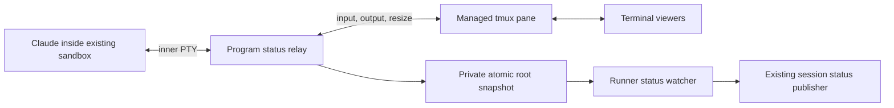

# Claude program status prototype

OMNI-12244 proposes using Claude Code's OSC 7501 reports to drive the working
indicator. It is enabled by default with a startup kill switch. It does not replace completion
hooks or enable the protocol for other harnesses.

## What determines working status today

| Harness path | Source of status |
| --- | --- |
| Claude native | `sessions/<pid>.json` under Claude's config directory, polled every 200 ms; pane activity when that file is unavailable. Busy/waiting mean running; idle/shell mean idle. `waitingFor` supplies the blocked reason. |
| Pi, Cursor, Kiro, Goose, Qwen, Kimi, Hermes native terminals | Shared pane watcher: changing screen means running; one second of quiet means idle. Harness forwarders can also publish status. |
| Codex native, OpenCode | Structured app-server events already supply lifecycle state. |
| SDK harnesses | Their runtime turn lifecycle supplies status; this terminal prototype does not apply. |

The UI considers running/waiting active and also accounts for background shells.
Claude's Stop/StopFailure hooks still deliver task outcomes and wake parents.
A display status report cannot replace those messages.

The file API is undocumented. Screen inference can mistake a quiet model/tool
operation for idle, or a prompt repaint for work. OSC 7501 explicitly distinguishes
idle, working, done, blocked and error, with optional reasons and child records.
Claude Code 2.1.295 introduced support; the standard CI pin is still 2.1.283
(the separate billing-notice lane uses 2.1.278).

## Transport decision

A first prototype observed raw tmux control-mode output and injected capability
replies. A synthetic peer passed, but actual Claude 2.1.295 rejected it: tmux
answered the following primary device-attributes query before the observer could
reply to OSC 7501. Claude treats that ordering as “unsupported.” `capture-pane`
loses OSC sequences altogether.

The revised prototype places a small PTY relay before tmux's output parser:



The relay runs outside the existing sandbox launcher, inside the managed tmux
pane. It answers and consumes only OSC 7501 capability queries before forwarding
remaining bytes to tmux. Other output passes through unchanged, including status
reports for capable viewers. It forwards stdin, terminal dimensions and signals,
reaps the command, and preserves its numeric exit code. It uses the runner's
Python interpreter and a standard-library-only script.

This adds a process and a PTY to each newly launched Claude-native terminal. The tradeoff is reliable
negotiation with unmodified tmux and no dependency on browser attachment. A
future tmux implementation of OSC 7501 could remove that need.

## Ownership and fallback

Claude OSC status is enabled by default, including when `OMNIGENT_FEATURES` is
unset, empty, or contains only unrelated features. To disable it, add the
negative override to the **host/runner environment**, preserving other entries:

```sh
OMNIGENT_FEATURES=-claude_osc_status
```

Explicit disables win even if the positive name is also present.

Restart the host and affected runners, then create a new Claude-native session.
The host forwards the feature set through CLI → daemon → runner. Setting it only
on a remote server does not change it on separately running hosts. Directly
launched runners read their own environment.

The flag is resolved once when the runner resource registry
starts. It applies only to the Claude terminal role; it is neither a frontend
capability nor part of portable agent specs. Existing terminals retain their
launch configuration; this is not a hot switch for an active session. To
re-enable, remove `-claude_osc_status`, restart the host/runners, and launch a
fresh terminal. The draft's earlier
`OMNIGENT_CLAUDE_OSC_STATUS` toggle is replaced and no longer enables the relay.
Review the temporary flag by release 0.20.0.

| Claude root report | Published status |
| --- | --- |
| working | running |
| blocked | running with a safe message or permission/question/auth reason |
| idle, done | idle |
| error | failed |
| clear or full reset | Relinquish OSC ownership; try the existing file, then pane inference |

Only root reports identifying `app=claude-code` own the session indicator.
Child records and other applications cannot overwrite it. This is a Claude
status consumer, not a complete general-purpose terminal record implementation:
child-record display, progress and durable done/error notifications are deferred.

A valid root snapshot persists through silence; no heartbeat or freshness timeout
is imposed. Tunnel reconnects and forwarded idle edges re-arm the next poll;
requests during a read remain pending for the following tick.
OSC 133 A clears working/blocked/idle;
RIS clears all state. Relay/process exit releases observation to the existing
terminal-exit handling. The legacy file lookup uses the inner command PID instead
of the relay's pane PID, retaining the existing Claude session-ID scan fallback.
Snapshot write failure must not terminate the command.

Parsing is incremental, bounded to 4096 bytes, and handles BEL/ST terminators,
fragmentation, cancellation, oversized strings and nested control strings. It
validates per-field limits, base64 and single-line text before applying a report.
Report text is display data, never an instruction or input to the terminal.
Invisible formatting characters are removed from the displayed blocked reason.

## Verification and acceptance

Run the focused suite with retries disabled:

```sh
uv run --no-sync pytest \
  tests/terminals/test_program_status.py \
  tests/runner/test_resource_registry.py \
  tests/inner/test_terminal.py \
  tests/terminals/test_launch_failure_cleanup.py \
  tests/harnesses/claude_native/test_claude_native_status_file.py \
  tests/harnesses/claude_native/test_claude_native_program_status.py \
  tests/server/test_feature_flags.py \
  tests/cli/test_host_daemon_env.py \
  tests/host/test_local_server.py \
  --reruns 0 -n 4 --dist loadfile -q
```

The runner scenario launches a protocol peer through the real registries, tmux
and relay, both unsandboxed and in the available native sandbox. It sends the
capability query and device-attributes query together and requires the OSC reply
first. It covers the disabled flag without a relay, a non-emitting peer with
the flag enabled, conflicting legacy state, elapsed-time
silence, blocked input, resize/input forwarding, root/child isolation, clear,
error, reconnect/forwarded-idle resync and process exit. A harness-level test
pauses an actual snapshot read to check that a concurrent resync survives it.
Existing terminal scenarios cover final output,
exit codes and cancellation with and without the relay. Parser matrices stay at
the byte-stream layer. Environment-boundary tests feed the CLI daemon and
runner environment builders into registry startup in local/remote server modes;
they do not spawn a host daemon. These peers do not substitute for a real Claude
canary.

Verify with Claude 2.1.295 or later in an isolated dev runner:

1. Leave `OMNIGENT_FEATURES` unset on the isolated host/runner to exercise the
   default, restart those processes, and start a new Claude-native session.
2. Submit a task with a long quiet tool operation. The indicator should stay
   working while the operation runs, including after closing and reopening the
   terminal viewer.
3. Trigger a permission or question prompt. Confirm the blocked reason appears;
   answer it and confirm work resumes. Cancel another turn and confirm idle.
4. Complete a turn and verify both idle display and the normal final message.
   Reconnect the runner tunnel and verify the state is restored.
5. Repeat with `OMNIGENT_FEATURES=-claude_osc_status` to verify the kill switch,
   and separately with an older/non-emitting Claude version under the default
   to check the existing fallback. Do not set `CLAUDE_CODE_DISABLE_TERMINAL_TITLE` when
   testing OSC: Claude also disables program status with that setting.

The PR records the exact candidate, actual CLI checks and remaining gaps.
Remaining acceptance includes actual Claude in Linux/bwrap, older-CLI fallback,
managed Omnigent/broker-proxy settings, and wider desktop/mobile entry points.
Local live-provider smoke and protocol-peer sandbox tests do not establish those
paths. Default activation follows local smoke and manual feedback; the kill
switch remains available. A separate change should upgrade CI's Claude pin.

## Sources

- [OSC 7501 specification](https://www.superlogical.com/rex/docs/build/program-status)
- [Program status rationale](https://mitchellh.com/writing/program-status-osc7501)
- [Claude Code 2.1.295 release notes](https://github.com/anthropics/claude-code/blob/main/CHANGELOG.md#21295)
- [Legacy Claude status reader](../omnigent/harnesses/claude_native/status_file.py)
- [Runner status arbitration](../omnigent/runner/resource_registry.py)
