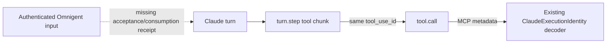

# Native Claude requester probe

This opt-in development plugin measures whether Claude mods expose enough
information to bind an Omnigent request to a later tool call. It **does not
enable delegation** or identify a human requester. The server's existing
verified-owner gate stays unchanged.

It complements the submit/control work in
[#11426](https://github.com/omnigent-ai/omnigent/pull/11426) and status work in
[#11427](https://github.com/omnigent-ai/omnigent/pull/11427). It introduces no
alternative submit channel and is not installed by any production launcher.

## What it measures



The observer records only identifiers, event kinds, prompt lengths, source
categories, and CLI version. It forwards prompts, tool calls, and response
chunks unchanged. It stores no prompt text, tool arguments or results.
The analyzer reports unique preceding emissions as `observed`, never as
authorization. Missing, duplicate, late, cross-session or cross-incarnation
observations remain unresolved. These writable diagnostic files are not
credentials and must never feed the server's authorization gate.

| Boundary | What the public contract provides | What it does not establish |
| --- | --- | --- |
| Prompt submission | Origin category; turn active when submitted; queue preference | Bryan/Pat identity; unique accepted-input receipt; actual consuming turn |
| Model step → call | Turn/agent IDs and streamed tool-use ID | Original human requester |
| MCP call | `claudecode/toolUseId`, already decoded by Omnigent | An authorization grant |

`turnId` on a mid-turn prompt describes submission timing. A queued prompt
need not be consumed by that turn. Never join idle prompts by text, order,
or the latest sender. A subsequent owner turn cannot authorize an older call.

## Run it

Use an isolated, approved Claude environment. No global plugin install is
needed; the plugin is loaded only for this command. Organization plugin
restrictions still apply.

```sh
probe_dir=$(mktemp -d)
OMNIGENT_CLAUDE_PROBE_DIR="$probe_dir" \
  claude --plugin-dir "$PWD/dev/claude_requester_probe"
# After exiting Claude, from the repository root:
python -m dev.claude_requester_probe.analyze "$probe_dir"
```

Type a harmless request that invokes a tool, then another request while work
is running. Check that the report contains matching emitted/called IDs and
always says `authorization: not_established`. Also repeat with ordinary
terminal typing and queued input. An empty capture is an error, not a pass.
Keep each run's directory separate. The probe adds diagnostic I/O, so it is
not a latency benchmark. Stop Claude before analyzing the complete capture.

## Verification

```sh
uv run --no-sync pytest tests/dev/test_claude_requester_probe.py --reruns 0
```

Handler tests execute the actual JavaScript module under Node with simulated
mod APIs. They cover retained stream IDs, interruption cleanup, dropped/error
inputs, absent opt-in and omission of prompt text. Analyzer cases check
ambiguous IDs, changed sessions/agents/incarnations and incomplete captures.

The separate real-process probe needs a non-root Linux container with
`--network none --cap-drop ALL --security-opt no-new-privileges`, no host
configuration or socket mounts, installed repository test dependencies,
Claude on PATH and a fresh writable temporary directory:

```sh
python -m pytest tests/e2e/test_claude_mod_requester_probe.py \
  --reruns 0 -vv -s --basetemp=/tmp/claude-mod-probe
```

It reuses the repository's scripted Anthropic provider and terminal-screen
driver, types into the real Claude TUI, holds a model request while another
input arrives, and correlates a built-in and an MCP call. The MCP fixture
captures actual wire metadata for the existing Omnigent locator decoder.
This distinct mod/interpreter/stdio boundary needs its own scenario; it
does not prove Omnigent startup, authenticated multi-user delegation, cloud
provisioning, or live-provider behavior. The isolation guard is reused from
the existing orchestration process scenario.

## Before authorization integration

Establish a trusted accepted-input receipt and actual consumption binding,
then test owner → collaborator steering → fresh owner → delayed old call.
Also cover provider helpers, interruption, resume, compaction, mod reload,
lost observations and coexistence with the submit/control mod. Keep unknown
work refused. A supported CLI floor and integration with the existing channel
remain decisions for the implementation PR, not defaults selected by this probe.

Sources: [mods overview](https://code.claude.com/docs/en/plugins/mods/overview),
[events](https://code.claude.com/docs/en/plugins/mods/events),
[API](https://code.claude.com/docs/en/plugins/mods/api),
[published declarations](https://github.com/anthropics/claude-code/blob/main/mods/types/claude-code.d.ts).
The declarations fetched for this prototype identify 2.1.277; the current
documentation describes newer releases. Pin actual tested versions separately.
