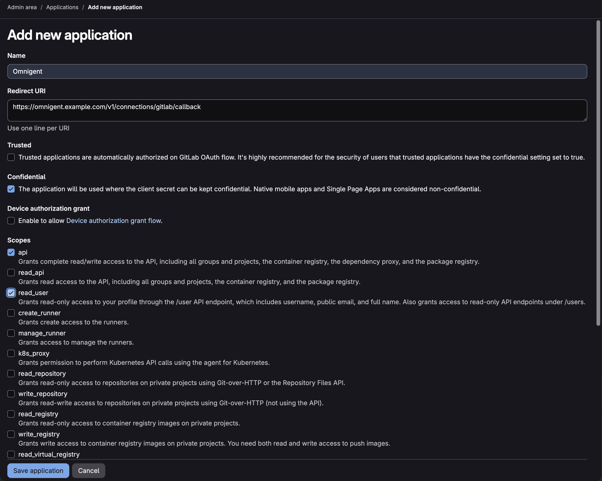
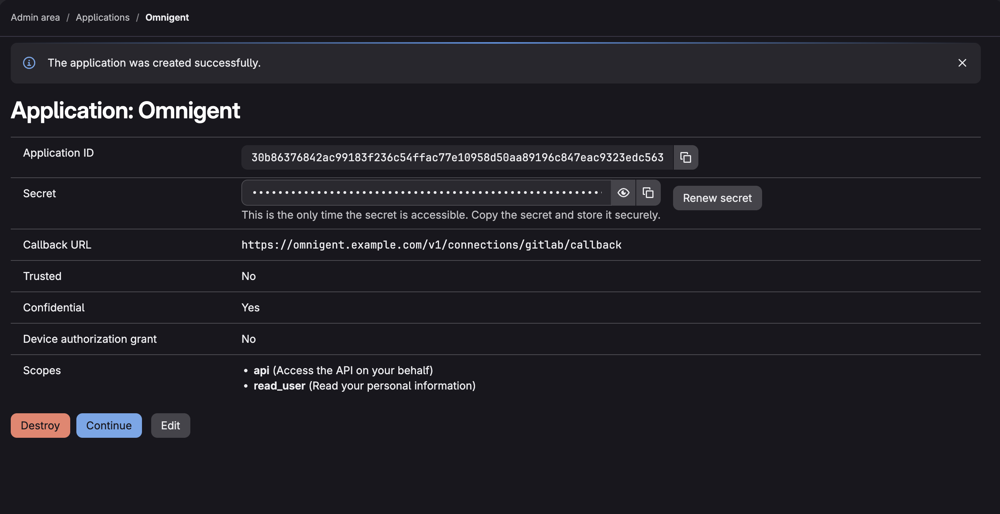

# GitLab OAuth and OIDC setup

Omnigent supports GitLab.com, GitLab Dedicated, and self-managed GitLab in two independent roles:

| Role | Purpose | Callback |
| --- | --- | --- |
| **Primary OIDC sign-in** | Sign users in to Omnigent with their GitLab identity | `/auth/callback` |
| **Sandbox Integration** | Give an already signed-in user GitLab API, Git HTTPS, and `glab` access in workspaces | `/v1/connections/gitlab/callback` |

GitLab sign-in works through Omnigent's existing generic OIDC support; the GitLab connection described below supplies workspace credentials. Enabling one role does not enable or replace the other. In particular, an OIDC login token is not copied into a sandbox, so a user who needs `git`, `glab`, project discovery, or merge-request operations must also connect the Sandbox Integration.

The GitLab instance origin is controlled by the operator; users cannot supply an arbitrary OAuth or API host.

## Sandbox Integration

The following setup configures the per-user workspace integration.

## 1. Create an OAuth application

In the configured GitLab instance, create a **confidential** OAuth application with this redirect URI:

```
https://<omnigent-domain>/v1/connections/gitlab/callback
```

Use the exact value configured in `OMNIGENT_GITLAB_APP_REDIRECT_URI` when that variable is set. For a server running locally on the default port 6767, register:

```
http://localhost:6767/v1/connections/gitlab/callback
```

`localhost` is suitable when the browser and Omnigent server run on the same machine. The redirect URI must match exactly, including scheme, hostname, port, path, and trailing slash behavior.



Use these application settings:

- **Confidential:** enabled, because Omnigent keeps the OAuth client secret on the server.
- **Trusted:** disabled, unless a GitLab administrator has explicitly approved bypassing user consent.
- **Device authorization grant:** disabled; Omnigent uses the browser authorization-code flow.
- **Scopes for the full integration:** `read_user` and `api`. The `api` scope is required for write-capable merge-request/API workflows.
- **Scopes for read-only local verification:** `read_user`, `read_api`, and `read_repository`. Configure the exact requested scopes with `OMNIGENT_GITLAB_APP_SCOPES='read_user read_api read_repository'`.



The OAuth application must allow every scope that Omnigent requests. Some GitLab instances restrict the available application scopes and do not offer `api`; in that case, use the read-only configuration above. It supports identity lookup, project and branch discovery, read-only merge-request API access, and HTTPS clone/fetch, but it cannot create or modify merge requests or push over HTTPS.

Do not enable unrelated privileged scopes such as `sudo`, runner management, Kubernetes proxy, registry write, or observability write. Never commit the client secret or pass a user personal access token into a managed workspace.

## 2. Configure Omnigent

The Sandbox Integration follows the same `OMNIGENT_<PROVIDER>_APP_*` naming convention as GitHub's sandbox integration. These variables are separate from `OMNIGENT_OIDC_*`, which configure primary sign-in.

Set the following server environment variables:

```bash
OMNIGENT_GITLAB_APP_CLIENT_ID=<oauth-application-id>
OMNIGENT_GITLAB_APP_CLIENT_SECRET=<oauth-application-secret>
OMNIGENT_GITLAB_APP_HOST=https://gitlab.example.com  # optional; defaults to https://gitlab.com
OMNIGENT_GITLAB_APP_REDIRECT_URI=https://omnigent.example.com/v1/connections/gitlab/callback
# Optional; defaults to "read_user api". Set this to scopes enabled in the GitLab OAuth application.
# OMNIGENT_GITLAB_APP_SCOPES='read_user read_api read_repository'

# Choose exactly one encrypted credential backend.
OMNIGENT_CREDENTIAL_KMS_KEY_ID=<AWS-KMS-key-id>
# Or Vault Transit (install the optional dependency with: uv sync --extra vault):
# OMNIGENT_CREDENTIAL_CIPHER=vault
# OMNIGENT_CREDENTIAL_VAULT_KEY=<derived-transit-key-name>
# VAULT_ADDR=https://vault.example.com
# VAULT_TOKEN=<Vault-token>
```

`OMNIGENT_GITLAB_APP_REDIRECT_URI` may be omitted when `OMNIGENT_DOMAIN` is set; Omnigent derives `https://$OMNIGENT_DOMAIN/v1/connections/gitlab/callback`.

`OMNIGENT_GITLAB_APP_HOST` must be an HTTPS origin only: no path, query, fragment, or embedded credentials are accepted. This deliberately makes GitLab Dedicated and self-managed hosts explicit deployment configuration.

## 3. Verify

1. Restart the server and check `GET /v1/info`; `enabled_connections` should include `gitlab`.
2. Check `GET /v1/connections/gitlab/status`; it should report `enabled: true` and `connected: false` before a user authorizes GitLab.
3. Connect GitLab from **Settings → Sandbox Integrations** and complete OAuth. Do not open the callback URL directly: GitLab supplies its one-time `code` and signed `state` parameters.
4. Check `GET /v1/connections/gitlab/repos`; it should list the connected user's visible projects, including nested GitLab namespaces.
5. In a managed sandbox for a GitLab workspace, run:

   ```bash
   git fetch
   glab auth status --hostname <configured-gitlab-hostname>
   glab mr list
   ```

Git retrieves the user credential on demand from Omnigent. `glab` receives a host-scoped entry in `~/.config/glab-cli/config.yml`; Omnigent refreshes that entry periodically for long-lived sessions. Do not print that file because it contains credentials.

For a local Vault-based setup, confirm the optional dependency is installed before starting the server:

```bash
uv sync --extra vault
uv run python -c 'import hvac; print("hvac is available")'
```

A successful local OAuth connection can be disconnected from **Settings → Sandbox Integrations → GitLab**. The same operation is available through `POST /v1/connections/gitlab/disconnect` for API clients.

After disconnecting, `GET /v1/connections/gitlab/status` should report `connected: false`.

## Primary sign-in with GitLab OIDC

A GitLab instance that exposes a standard discovery document at `https://<gitlab-host>/.well-known/openid-configuration` can be used as Omnigent's primary authentication provider without GitLab-specific server code.

Create a **confidential** GitLab application for sign-in with this exact redirect URI:

```
https://<omnigent-domain>/auth/callback
```

For local development, use:

```
http://localhost:6767/auth/callback
```

Grant the application the `openid`, `email`, and `profile` scopes, then configure the server:

```bash
OMNIGENT_AUTH_ENABLED=1
OMNIGENT_AUTH_PROVIDER=oidc
OMNIGENT_OIDC_ISSUER=https://gitlab.example.com
OMNIGENT_OIDC_CLIENT_ID=<oidc-application-id>
OMNIGENT_OIDC_CLIENT_SECRET=<oidc-application-secret>
OMNIGENT_OIDC_REDIRECT_URI=https://omnigent.example.com/auth/callback
OMNIGENT_OIDC_SCOPES='openid email profile'
# Generate once with `openssl rand -hex 32`, store securely, and reuse across restarts.
OMNIGENT_OIDC_COOKIE_SECRET=<at-least-64-hex-characters>
```

`OMNIGENT_AUTH_ENABLED=1` without `OMNIGENT_OIDC_ISSUER` selects Omnigent's built-in accounts provider instead. Setting `OMNIGENT_AUTH_PROVIDER=oidc` explicitly avoids ambiguity and makes incomplete OIDC configuration fail at startup.

The OIDC redirect is intentionally different from the Sandbox Integration redirect and configuration namespace:

```bash
OMNIGENT_OIDC_REDIRECT_URI='http://localhost:6767/auth/callback'
OMNIGENT_GITLAB_APP_REDIRECT_URI='http://localhost:6767/v1/connections/gitlab/callback'
```

After restarting the server, begin the sign-in flow at `/auth/login`. GitLab must return the browser to `/auth/callback`; a return to `/v1/connections/gitlab/callback` means the Sandbox Integration flow was started instead.

Verify the resolved mode before testing:

```bash
uv run python - <<'PY'
from omnigent.server.auth import resolve_auth_source
from omnigent.server.oidc import OIDCConfig

config = OIDCConfig.from_env()
print("auth source:", resolve_auth_source())
print("issuer:", config.issuer)
print("redirect URI:", config.redirect_uri)
print("scopes:", config.scopes)
PY
```

The auth source should be `oidc`, and the redirect URI should end in `/auth/callback`.

## Using sign-in and Sandbox Integration together

Use separate GitLab applications for the two roles when possible. This keeps callback URIs, scopes, client credentials, consent, and rotation independent:

1. **Omnigent Login:** `/auth/callback` with `openid email profile`.
2. **Omnigent Sandbox Integration:** `/v1/connections/gitlab/callback` with `read_user api`, or the documented read-only scopes.

A single GitLab application can serve both roles only if it registers both exact redirect URIs and permits all requested scopes, but separate applications are easier to audit and troubleshoot.

The complete user flow is:

1. The user signs in to Omnigent through GitLab OIDC.
2. The user opens **Settings → Sandbox Integrations → GitLab** and connects GitLab separately.
3. Omnigent stores that second grant in the encrypted credential store and brokers it to workspaces for Git HTTPS and `glab`.

The second authorization is expected: primary OIDC establishes the Omnigent identity and session, while the Sandbox Integration grant provides the broader, refreshable GitLab credentials required inside managed workspaces.
