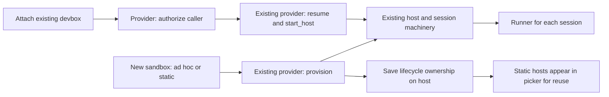

# Prototype: reusable sandboxes through existing providers

A reusable sandbox is a normal host created by a provider or attached later. Its
`sandbox_attached` marker makes it reusable in host pickers and records that
Omnigent does not own the box's lifecycle. Ordinary per-session sandbox hosts
remain hidden. One provider may offer both kinds.



Only hosts marked reusable appear as sandbox entries. The new-session picker can
wake a sleeping static host before browsing directories. Once online, the same
host can launch multiple independent session runners. Existing sessions reuse
the normal resume path. Deleting one session leaves the host and other sessions
alone. Reaping, startup failure and missing-box recovery never delete or replace
an attached box. Omnigent also leaves its keepalive policy to the customer.

## Create through the normal sandbox option

A provider opts its new sandboxes into reuse with the existing capability object:

```python
from dataclasses import replace

@property
def capabilities(self):
    return replace(super().capabilities, reusable_hosts=True, resume_stopped=True)
```

The regular new-session provider option becomes **New static sandbox**.
It calls the existing `provision` and `start_host` methods, including repository
setup. The resulting host is saved with the same ownership marker and appears in
host pickers for later sessions. No separate Add static sandbox dialog or creation
API is needed. The capability only selects the initial policy: changing provider
configuration later cannot turn a saved static box into an ad hoc one.

`provision` must create a fresh box. To adopt an existing or per-user box, use the
attachment action below. Providers may expose separate static/ad hoc entries in
the existing registry, for example Arca and Arclet, backed by their own controller.

## Provider contract

Keep the customer controller and HTTP client in the existing
[provider plugin](sandbox_providers.md). No generic HTTP adapter, second provider
interface, discovery service or external provider store is required upstream.

The one new optional method is:

```python
def attach_for_user(self, sandbox_id: str, *, owner: str) -> None:
    # Customer code: authenticate to your controller and authorize this caller
    # for this exact box. Service credentials alone are not user authorization.
    if not self.controller.can_control(owner, sandbox_id):
        raise PermissionError("not your sandbox")
```

Existing methods handle the rest:

| Method | Customer implementation |
| --- | --- |
| `resume(sandbox_id)` | Wake that existing box; never silently allocate a replacement. |
| `start_host(sandbox_id, token=..., host_id=..., ...)` | Ask the controller to start/reconnect `omnigent host` with the supplied identity and token; return its workspace path. |
| `provision` | Create a fresh box through the normal New sandbox flow; `reusable_hosts` opts its host into reuse. Attachment never calls this method. |
| `terminate` | Used for ad hoc sandboxes. Never called for a saved reusable box, including when startup fails. |

Declare the existing `resume_stopped` capability. The default `attach_for_user`
rejects requests, so installed providers do not opt in accidentally. Providers
must reject boxes managed by an ad hoc allocation system and missing or foreign
IDs. Use stable, canonical IDs; aliases for the same box are not supported.
Each box has one host owner per workspace. Separate launchers are constructed
on later wakes, so methods must resolve the box by ID without relying on an
earlier attachment call's in-memory state.

HTTP is only the customer's control channel. Agents still run through the
existing outbound host/runner connections. The controller must honor the supplied
host identity and token; returning an HTTP endpoint alone is insufficient.

## Try it

After the [schema/application rollout](../sandbox-attachment-rollout.md), install
and configure an opt-in provider on an isolated server. Open New session, select
**New static sandbox** and submit a prompt. Once the session starts, open
New session again: its `static-...` host should now be available to select. Create
a second session on that host, then delete the first; the second must stay bound
and the provider must not delete the box.

To attach a pre-existing box instead, authenticate as its owner and call:

```http
POST /v1/hosts/attach
Content-Type: application/json

{"provider":"static","sandbox_id":"my-existing-box","name":"My devbox"}
```

This waits for the ordinary host connection and returns `{"host_id":"..."}`.
Retries reuse the same host and keep its original name. An authorized but failed
startup leaves the attachment available for retry. `GET /v1/hosts` and the host
detail response expose `sandbox_attached`; older servers omit it, preserving the
old picker behavior. `POST /v1/hosts/{host_id}/wake` wakes an attachment, and
`DELETE /v1/hosts/{host_id}` removes the attachment and revokes its credential
without deleting the box. Detachment unbinds its sessions; it does not stop
processes already running on the customer's machine.

Open New session, pick **My devbox**, choose a directory and start a session.
Repeat for a second session, then delete the first: the second stays bound to
the same host. Sleep the box through the controller, then click its **Asleep**
entry to wake it. Ordinary ad hoc sandbox hosts must never appear in that menu.
Use separate directories or the existing worktree option for concurrent edits.

## Prototype limits

Creating a static box uses the normal provider option. Attaching a pre-existing
box and detaching a host use the API; there is no discovery or Add dialog. The
new-session picker has the wake action; other pickers reuse an
attachment once it is online. Automations retain their existing sandbox
restrictions. Cross-replica wake coordination retains the existing resume
implementation's limits; it is not a new distributed lease mechanism.

Arca's current self-authenticating host startup does not yet honor this token
contract. Its adapter must be updated, or a subsequent change must support that
startup mode in the existing host path. This prototype does not change MAS or
Arclet and has not been validated against a real customer controller.
