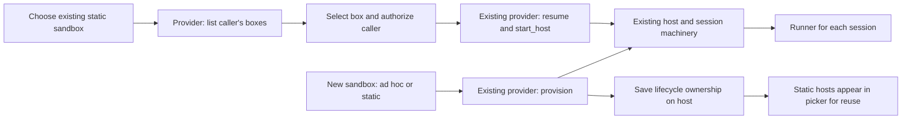
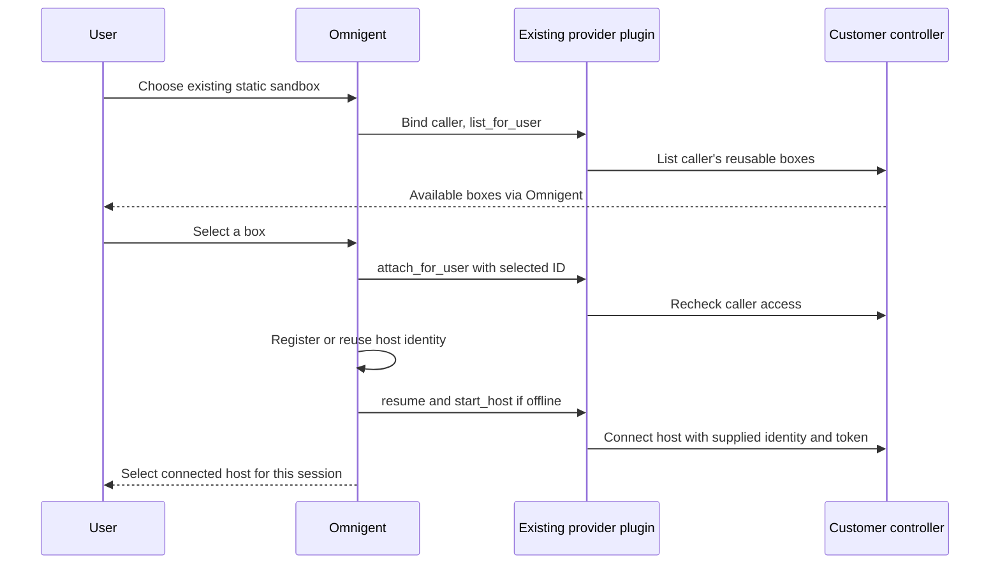

# Prototype: reusable sandboxes through existing providers

A reusable sandbox is a normal host created by a provider or attached later. Its
`sandbox_attached` marker makes it reusable in host pickers and records that
Omnigent does not own the box's lifecycle. Ordinary per-session sandbox hosts
remain hidden. One provider may offer both kinds.



Only hosts marked reusable appear as sandbox entries. The new-session picker can
wake a sleeping static host before browsing directories. Once online, the same
host can launch multiple independent session runners. Existing sessions reuse
the normal resume path. Deleting one session leaves the host and other sessions
alone. Reaping, startup failure and missing-box recovery never delete or replace
an attached box. Omnigent also leaves its keepalive policy to the customer.

## Create through the normal sandbox option

A provider opts its new sandboxes into reuse with the existing capability object:

```python
from dataclasses import replace

@property
def capabilities(self):
    return replace(super().capabilities, reusable_hosts=True, resume_stopped=True)
```

The regular new-session provider option becomes **New static sandbox**.
It calls the existing `provision` and `start_host` methods, including repository
setup. The resulting host is saved with the same ownership marker and appears in
host pickers for later sessions. Each new session submitted with this option
creates another box. No new creation API is needed. The capability only selects the initial policy: changing provider
configuration later cannot turn a saved static box into an ad hoc one.

`provision` must create a fresh box. To adopt an existing or per-user box, use the
attachment action below. Providers may expose separate static/ad hoc entries in
the existing registry, backed by their own controller.

## Discover and reuse existing boxes

**+ Existing Static Sandbox** at the bottom of the host picker in New session
and Clone session lists the
controller's inventory for the authenticated caller. Users can have several
boxes, including ones created before they used Omnigent. Opening or refreshing
the list does not register, wake, or create anything. Selecting a box uses the
existing attachment action, which checks access again, reuses its host
registration if present, and connects it. Later sessions can select that host
directly from the ordinary host picker.

There is no get-or-create operation or assumption of one box per user. Creation
always goes through `provision`; reuse goes through explicit selection.

Discovery does not require creation. A controller that only manages existing
boxes can declare:

```python
@property
def capabilities(self):
    return replace(
        super().capabilities,
        managed_launch=False,
        reusable_hosts=True,
        resume_stopped=True,
    )
```

Set `managed_launch_supported=False` in the contributed
`SandboxProviderMetadata` (or in a directly injected `ManagedSandboxConfig`).
This opt-out defaults to true: existing providers remain launchable even if
they return a partial capability object with `managed_launch` unset. Config
parsing does not construct the launcher to decide whether creation is enabled.
The provider still implements discovery, authorization, preparation, resume and
host startup; `provision` can retain its default unsupported implementation.

`GET /v1/info` lists creation providers in `sandbox_providers` and advertises
`reusable_hosts` independently in `sandbox_provider_capabilities`. Both session
pickers show **+ Existing Static Sandbox** even when there are no connected
hosts and `managed_sandboxes_enabled` is false. **New static sandbox** appears
only when creation is supported. Direct creation requests to a discovery-only
provider are rejected without provisioning. A failed creation attempt does not
disable discovery; discovery and attachment never call `provision`.

## Provider contract

Keep the customer controller and HTTP client in the existing
[provider plugin](sandbox_providers.md). No generic HTTP adapter, second provider
interface or external provider store is required upstream. Discovery adds one
optional method to the existing provider contract, defaulting to an empty list:

```python
from omnigent.onboarding.sandboxes.types import SandboxInfo

def list_for_user(self, *, owner: str):
    # Only return stable IDs for reusable boxes this caller may control.
    return [
        SandboxInfo(sandbox_id=box.id, name=box.name)
        for box in self.controller.list_boxes(owner)
    ]
```

`SandboxInfo.name` is optional and falls back to the ID. `SandboxInfo.state`
optionally supplies a controller-reported string such as `running` or `stopped`;
omission means unknown. Discovery displays that state as information, never as
a launch gate. It is not saved or polled in the background. Host `status` still
means the existing heartbeat-based online/offline status; a running box need
not have a connected host. Other metadata is not sent to the browser. The controller supplies the current inventory; Omnigent
only saves a host registration after selection, not a copy of that inventory.

The attachment authorization hook is optional and rejects requests by default:

```python
def attach_for_user(self, sandbox_id: str, *, owner: str) -> None:
    # Customer code: authenticate to your controller and authorize this caller
    # for this exact box. Service credentials alone are not user authorization.
    if not self.controller.can_control(owner, sandbox_id):
        raise PermissionError("not your sandbox")
```

The server also calls the optional `bind_principal(principal)` hook before any
user-scoped provider operation. It defaults to a no-op for existing providers.
An HTTP provider can use it to configure its controller client's user header.
Creation, discovery and attachment use the authenticated account identity; later wake,
startup, status, relaunch, termination, keepalive and background cleanup use the
saved host owner. The value is an opaque account identifier, not necessarily an
email address, and never an owner supplied in the request body. It is identity
context, not a forwarded user access token: the controller must authenticate the
server and authorize the operation for that principal.

The launcher factory must return a fresh instance, since the bound identity must
never be shared across users. Background cleanup groups hosts by workspace,
provider and owner. Deployment-wide capability inspection and operator-owned
warm-pool tooling remain unbound; constructors and capability properties must
not require an end-user identity.

Existing lifecycle methods handle the rest:

| Method | Customer implementation |
| --- | --- |
| `resume(sandbox_id)` | Wake that existing box; never silently allocate a replacement. |
| `start_host(sandbox_id, token=..., host_id=..., ...)` | Ask the controller to start/reconnect `omnigent host` with the supplied identity and token; return its workspace path. |
| `provision` | Create a fresh box through the normal New sandbox flow; `reusable_hosts` opts its host into reuse. Attachment never calls this method. |
| `terminate` | Used for ad hoc sandboxes. Never called for a saved reusable box, including when startup fails. |

Declare the existing `resume_stopped` capability. The default `attach_for_user`
rejects requests, so installed providers do not opt in accidentally. Providers
must reject boxes managed by an ad hoc allocation system and missing or foreign
IDs. Use stable, canonical IDs; aliases for the same box are not supported.
Each box has one host owner per workspace. Separate launchers are constructed
on later wakes, so methods must resolve the box by ID without relying on an
earlier attachment call's in-memory state.

HTTP is only the customer's control channel. Agents still run through the
existing outbound host/runner connections. The controller must honor the supplied
host identity and token; returning an HTTP endpoint alone is insufficient.

## Friendly names owned by Omnigent

`hosts.display_name` is an optional user-owned label, independent of the existing
registration `name` and the provider's sandbox ID. After selecting a static
sandbox in New session or Clone session, use the pencil button to rename it.
The label appears in host pickers, the session badge, and host setup screens.
Clearing it restores the existing host name. Duplicate display names are allowed.

Only the host owner can rename a reusable host. Renaming does not contact the
controller, change credentials, change the registration name, or touch the
heartbeat timestamp. Reconnecting and reattaching preserve the label. Removing
the registration removes its label; this is not a separate inventory of boxes.

The existing row already contains workspace, owner, provider, sandbox ID, host
ID and creation time. No metadata JSON or second provider store is needed for
this mapping. Providers do not need to read or write the new label field.

## HTTP surface

These additions under `/v1/hosts` are sandbox-specific. Ordinary host listing
and session launch APIs keep their existing purpose.

| API | Purpose |
| --- | --- |
| `GET /v1/hosts/sandboxes?provider=…` | New: read the caller's controller inventory as `{sandboxes: [{sandbox_id, name, state}]}`. Requires `reusable_hosts`. |
| `POST /v1/hosts/attach` | Authorize `{provider, sandbox_id, name}`, register or reuse the host, wake/connect it, return `{host_id}`. |
| `POST /v1/hosts/{host_id}/wake` | Wake a saved reusable host before selecting a working directory. |
| `PATCH /v1/hosts/{host_id}` | Set `{display_name: "My project"}` or clear with `{display_name: null}` for an owned reusable host. Return `{host_id, display_name}`. |
| `DELETE /v1/hosts/{host_id}` | Remove a reusable registration and its credentials, without deleting the box. |
| Existing session creation | A provider choice creates a fresh box. A host choice reuses that host. |



## Workspace policy

The controller can choose an existing checkout, a per-session worktree, or
another directory. Omnigent only needs the chosen path to start the session's
runner there; being a static sandbox does not require a particular policy.
Today users can choose directories and use the existing worktree settings.
A controller-driven per-session workspace policy still needs an integration at
session startup that requests and uses that path. `start_host` alone cannot
provide this: a running host can serve many new sessions without starting again.

## Try it

After the [schema/application rollout](../sandbox-attachment-rollout.md), install
and configure an opt-in provider on an isolated server. Open New session, select
**New static sandbox** and submit a prompt. Once the session starts, open
New session again: the created host should now be available to select. Create
a second session on that host, then delete the first; the second must stay bound
and the provider must not delete the box.

To attach a pre-existing box instead, authenticate as its owner and call:

```http
POST /v1/hosts/attach
Content-Type: application/json

{"provider":"static","sandbox_id":"my-existing-box","name":"My devbox"}
```

This waits for the ordinary host connection and returns `{"host_id":"..."}`.
Retries reuse the same host and keep its original name. An authorized but failed
startup leaves the attachment available for retry. `GET /v1/hosts` and the host
detail response expose `sandbox_attached` and nullable `display_name`; older servers omit it, preserving the
old picker behavior. `POST /v1/hosts/{host_id}/wake` wakes an attachment, and
`DELETE /v1/hosts/{host_id}` removes the attachment and revokes its credential
without deleting the box. Detachment unbinds its sessions; it does not stop
processes already running on the customer's machine.

Open New session, pick **My devbox**, choose a directory and start a session.
Repeat for a second session, then delete the first: the second stays bound to
the same host. Sleep the box through the controller, then click its **Asleep**
entry to wake it. Ordinary ad hoc sandbox hosts must never appear in that menu.
Use separate directories or the existing worktree option for concurrent edits.

Create another session with **New static sandbox** and verify it gets a different
box. Have the controller create a box independently, then choose **+ Existing
Static Sandbox**, select it and start a session. Refreshing the list must not
start any boxes. Repeat selection and verify the same host registration is reused.

With creation disabled, verify that **New static sandbox** disappears while
**+ Existing Static Sandbox** remains available in both New session and Clone
session, including before any hosts are registered. Discover a box, connect it
and reuse it for two sessions without any controller creation call.

## Prototype limits

Discovery and attachment are available in New session and Clone session.
Detaching still uses the API. The new-session picker has the direct wake action;
other pickers reuse an attachment once it is online, or connect through discovery.
Automations retain their existing sandbox
restrictions. Cross-replica wake coordination retains the existing resume
implementation's limits; it is not a new distributed lease mechanism.

Self-authenticating hosts need an adapter for this token contract, or a subsequent
change must support their startup mode in the existing host path. This prototype
has not been validated against a real customer controller.
