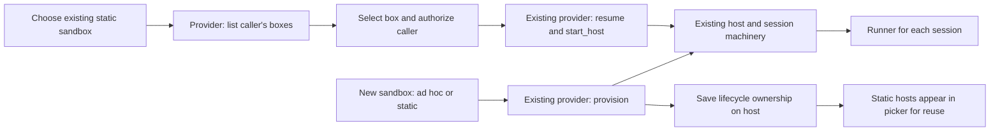
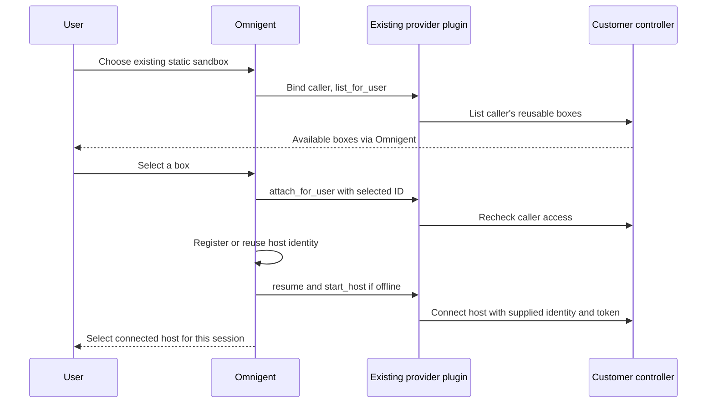
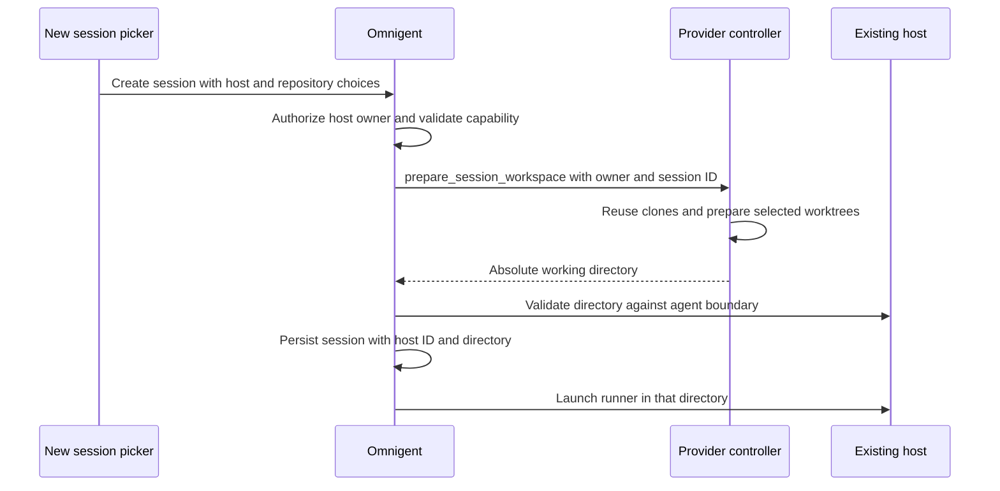
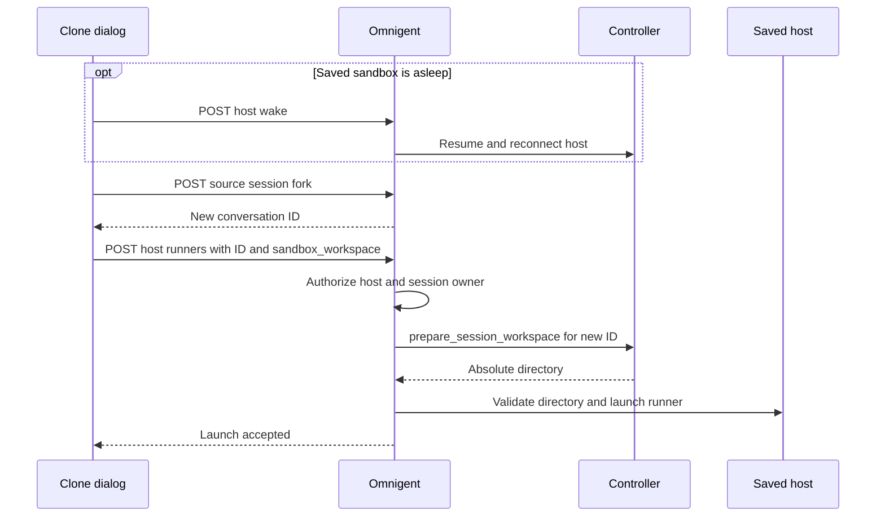

# Prototype: reusable sandboxes through existing providers

A reusable sandbox is a normal host created by a provider or attached later. Its
`sandbox_attached` marker makes it reusable in host pickers and records that
Omnigent does not own the box's lifecycle. Ordinary per-session sandbox hosts
remain hidden. One provider may offer both kinds.



Only hosts marked reusable appear as sandbox entries. The new-session picker can
wake a sleeping static host before browsing directories. Once online, the same
host can launch multiple independent session runners. Existing sessions reuse
the normal resume path. Deleting one session leaves the host and other sessions
alone. Reaping, startup failure and missing-box recovery never delete or replace
an attached box. Omnigent also leaves its keepalive policy to the customer.

## Create through the normal sandbox option

A provider opts its new sandboxes into reuse with the existing capability object:

```python
from dataclasses import replace

@property
def capabilities(self):
    return replace(super().capabilities, reusable_hosts=True, resume_stopped=True)
```

The regular new-session provider option becomes **New static sandbox**.
It calls the existing `provision` and `start_host` methods, including repository
setup. The resulting host is saved with the same ownership marker and appears in
host pickers for later sessions. Each new session submitted with this option
creates another box. No new creation API is needed. The capability only selects the initial policy: changing provider
configuration later cannot turn a saved static box into an ad hoc one.

`provision` must create a fresh box. To adopt an existing or per-user box, use the
attachment action below. Providers may expose separate static/ad hoc entries in
the existing registry, backed by their own controller.

## Discover and reuse existing boxes

**+ Existing Static Sandbox** at the bottom of the host picker in New session
and Clone session lists the
controller's inventory for the authenticated caller. Users can have several
boxes, including ones created before they used Omnigent. Opening or refreshing
the list does not register, wake, or create anything. Selecting a box uses the
existing attachment action, which checks access again, reuses its host
registration if present, and connects it. Later sessions can select that host
directly from the ordinary host picker.

There is no get-or-create operation or assumption of one box per user. Creation
always goes through `provision`; reuse goes through explicit selection.

Discovery does not require creation. A controller that only manages existing
boxes can declare:

```python
@property
def capabilities(self):
    return replace(
        super().capabilities,
        managed_launch=False,
        reusable_hosts=True,
        resume_stopped=True,
    )
```

Set `managed_launch_supported=False` in the contributed
`SandboxProviderMetadata` (or in a directly injected `ManagedSandboxConfig`).
This opt-out defaults to true: existing providers remain launchable even if
they return a partial capability object with `managed_launch` unset. Config
parsing does not construct the launcher to decide whether creation is enabled.
The provider still implements discovery, authorization, preparation, resume and
host startup; `provision` can retain its default unsupported implementation.

`GET /v1/info` lists creation providers in `sandbox_providers` and advertises
`reusable_hosts` independently in `sandbox_provider_capabilities`. Both session
pickers show **+ Existing Static Sandbox** even when there are no connected
hosts and `managed_sandboxes_enabled` is false. **New static sandbox** appears
only when creation is supported. Direct creation requests to a discovery-only
provider are rejected without provisioning. A failed creation attempt does not
disable discovery; discovery and attachment never call `provision`.

## Project defaults

After attaching a static sandbox, choose it in **Project settings → Host**.
Saved boxes appear under their user-owned names even while offline; ordinary
ad hoc sandbox hosts remain hidden. Saving the default stores the existing
project `host_id` and does not wake or create a box.

Opening **New session** for that project selects the saved box and, if offline,
wakes it before loading its folders and models, matching manual host selection.
A failed wake preserves the selected box and draft; select its row in the host
picker to retry. It never falls back to a different host because the saved static
box is offline. No new project field, controller method or HTTP endpoint is added.
Repository/worktree preparation remains a per-session choice.

## Provider contract

Keep the customer controller and HTTP client in the existing
[provider plugin](sandbox_providers.md). No generic HTTP adapter, second provider
interface or external provider store is required upstream. Discovery adds one
optional method to the existing provider contract, defaulting to an empty list:

```python
from omnigent.onboarding.sandboxes.types import SandboxInfo

def list_for_user(self, *, owner: str):
    # Only return stable IDs for reusable boxes this caller may control.
    return [
        SandboxInfo(sandbox_id=box.id, name=box.name)
        for box in self.controller.list_boxes(owner)
    ]
```

`SandboxInfo.name` is optional and falls back to the ID. `SandboxInfo.state`
optionally supplies a controller-reported string such as `running` or `stopped`;
omission means unknown. Discovery and saved sandbox rows display that state as
information, never as a launch gate. It is not saved or polled in the background. Host `status` still
means the existing heartbeat-based online/offline status; a running box need
not have a connected host. Other metadata is not sent to the browser. The controller supplies the current inventory; Omnigent
only saves a host registration after selection, not a copy of that inventory.

Opening either host picker reads the same inventory endpoint for saved static
boxes, matching by provider and sandbox ID. Requests share a per-user/provider
cache for 30 seconds, time out after five seconds, and refresh on reopening
after the cache expires. Wake and attachment invalidate the cache. Stale values
are labeled **Last reported**; failed lookups show **State unavailable** without
preventing host selection or reuse. Missing boxes or omitted state leave the
existing connection indicator alone; neither means stopped or deleted.
Controllers with no state information need no changes. The host list/detail
responses include nullable `sandbox_id` for matching; older responses that omit
it retain the existing picker behavior. A running box can have an offline host.

The attachment authorization hook is optional and rejects requests by default:

```python
def attach_for_user(self, sandbox_id: str, *, owner: str) -> None:
    # Customer code: authenticate to your controller and authorize this caller
    # for this exact box. Service credentials alone are not user authorization.
    if not self.controller.can_control(owner, sandbox_id):
        raise PermissionError("not your sandbox")
```

The server also calls the optional `bind_principal(principal)` hook before any
user-scoped provider operation. It defaults to a no-op for existing providers.
An HTTP provider can use it to configure its controller client's user header.
Creation, discovery and attachment use the authenticated account identity; later wake,
startup, status, relaunch, termination, keepalive and background cleanup use the
saved host owner. The value is an opaque account identifier, not necessarily an
email address, and never an owner supplied in the request body. It is identity
context, not a forwarded user access token: the controller must authenticate the
server and authorize the operation for that principal.

The launcher factory must return a fresh instance, since the bound identity must
never be shared across users. Background cleanup groups hosts by workspace,
provider and owner. Deployment-wide capability inspection and operator-owned
warm-pool tooling remain unbound; constructors and capability properties must
not require an end-user identity.

Existing lifecycle methods handle the rest:

| Method | Customer implementation |
| --- | --- |
| `resume(sandbox_id)` | Wake that existing box; never silently allocate a replacement. |
| `start_host(sandbox_id, token=..., host_id=..., ...)` | Ask the controller to start/reconnect `omnigent host` with the supplied identity and token; return its workspace path. |
| `provision` | Create a fresh box through the normal New sandbox flow; `reusable_hosts` opts its host into reuse. Attachment never calls this method. |
| `terminate` | Used for ad hoc sandboxes. Never called for a saved reusable box, including when startup fails. |

Declare the existing `resume_stopped` capability. The default `attach_for_user`
rejects requests, so installed providers do not opt in accidentally. Providers
must reject boxes managed by an ad hoc allocation system and missing or foreign
IDs. Use stable, canonical IDs; aliases for the same box are not supported.
Each box has one host owner per workspace. Separate launchers are constructed
on later wakes, so methods must resolve the box by ID without relying on an
earlier attachment call's in-memory state.

HTTP is only the customer's control channel. Agents still run through the
existing outbound host/runner connections. The controller must honor the supplied
host identity and token; returning an HTTP endpoint alone is insufficient.

## Friendly names owned by Omnigent

`hosts.display_name` is an optional user-owned label, independent of the existing
registration `name` and the provider's sandbox ID. In the New session or Clone session host picker, use **Edit** beside a static
sandbox entry to rename it. Editing does not select or wake the box. With a row
focused, press Right Arrow to edit its name.
The label appears in host pickers, the session badge, and host setup screens.
Clearing it restores the existing host name. Duplicate display names are allowed.

Only the host owner can rename a reusable host. Renaming does not contact the
controller, change credentials, change the registration name, or touch the
heartbeat timestamp. Reconnecting and reattaching preserve the label. Removing
the registration removes its label; this is not a separate inventory of boxes.

The existing row already contains workspace, owner, provider, sandbox ID, host
ID and creation time. No metadata JSON or second provider store is needed for
this mapping. Providers do not need to read or write the new label field.

## HTTP surface

These additions under `/v1/hosts` are sandbox-specific. Ordinary host listing
and session launch APIs keep their existing purpose.

| API | Purpose |
| --- | --- |
| `GET /v1/hosts/sandboxes?provider=…` | New: read the caller's controller inventory as `{sandboxes: [{sandbox_id, name, state}]}`. Requires `reusable_hosts`. |
| `POST /v1/hosts/attach` | Authorize `{provider, sandbox_id, name}`, register or reuse the host, wake/connect it, return `{host_id}`. |
| `POST /v1/hosts/{host_id}/wake` | Wake a saved reusable host before selecting a working directory. |
| `PATCH /v1/hosts/{host_id}` | Set `{display_name: "My project"}` or clear with `{display_name: null}` for an owned reusable host. Return `{host_id, display_name}`. |
| `DELETE /v1/hosts/{host_id}` | Remove a reusable registration and its credentials, without deleting the box. |
| Existing host list/detail | Include nullable `sandbox_id` alongside provider, label and connection status, so pickers can match optional inventory state. |
| Existing session creation | A provider choice creates a fresh box. A host choice reuses that host. |



## Workspace policy

Providers can opt into repository choices in **New session** and **Clone session** by advertising
`SandboxCapabilities(reusable_hosts=True, session_workspaces=True)` (and
`multi_repo=True` for several repositories). This works with saved boxes and
newly created static sandboxes. Discovery-only providers can support it too.
Without this capability, the existing directory picker and launch paths remain
unchanged.

The searchable branch picker accepts existing branches and typed branch names:

| Per-repo choice | Create worktrees | Controller behavior |
| --- | --- | --- |
| No branch | Off | Reuse the shared checkout |
| No branch | On | Allocate a fresh branch and worktree for this session |
| Explicit branch | Either | Use that branch in a worktree; create the branch if absent |

The toggle applies only to repositories without an explicit branch. No repos
means the controller's default workspace. Multiple repositories share a parent
working directory chosen by the controller; one repo can start directly in its
checkout/worktree. A branch already checked out elsewhere must be reused safely
or rejected by the controller, never silently force-checked out.

### Additive session API

`POST /v1/sessions` accepts an optional `sandbox_workspace` object. This adds no
endpoint or database column. It is mutually exclusive with `workspace`,
`workspaces`, and `git`, and only applies to top-level sessions.

```json
{
  "agent_id": "ag_example",
  "host_id": "saved-host-id",
  "sandbox_workspace": {
    "repositories": [
      "https://github.com/example/api.git#release",
      "https://github.com/example/web.git#feature/navigation"
    ],
    "create_worktrees": false
  }
}
```

For a new static sandbox, replace `host_id` with `host_type: "managed"` and
`sandbox_provider`. The server provisions an empty sandbox through the existing
provider, then prepares this session's workspace before launching its runner.

### Controller hook

```python
def prepare_session_workspace(
    self,
    sandbox_id: str,
    *,
    session_id: str,
    repos: Sequence[RepoWorkspace],
    create_worktrees: bool = False,
) -> str:
    # Delegate to your controller and return its absolute working directory.
    ...
```

The launcher has the authenticated owner and current credential resolver bound
before this call. The controller must authorize that owner for the box and the
repositories. Its adapter owns HTTP details, timeouts, cached clones, Git
operations, concurrency, directory layout, and cleanup. Requests for the same
`session_id` should be idempotent; requests for different sessions must preserve
other sessions' checkouts. The branch list comes from the existing GitHub
connection; pasted URLs and typed branches work when that list is unavailable.



A saved host is authorized before any controller call; its returned directory
uses the existing host filesystem and agent-boundary checks. Workspace
preparation on a saved box is awaited by session creation; new-box creation
keeps the existing background launch flow. Preparation errors stop runner launch.
A box created before a preparation failure remains saved for reuse.

Resume uses the stored directory without preparing another worktree. These
controller-owned workspaces do not set the generic `git_branch` cleanup marker;
Omnigent does not delete the controller's worktrees. Controllers should reclaim
abandoned preparations if session persistence fails after a directory is made.

### Clone into a controller workspace

Clone uses the same repository and branch controls. On the source sandbox it
defaults to **Use source working folder**, preserving the files and current
branches in that directory. Uncheck it to ask the controller to prepare a
workspace. Selecting another saved sandbox or **New static sandbox** also offers
workspace preparation. Sleeping saved sandboxes wake when selected; creation
can be disabled independently.

The fields prefill from the source's recorded repository choices and worktree
mode. For a single repo, the session's recorded Git branch takes precedence.
This is not a live snapshot of every checkout: branches changed outside
Omnigent and uncommitted files are not copied to a different workspace.

Two existing requests gain the same optional object; no endpoint or schema
migration is added:

| Destination | Requests |
| --- | --- |
| New static sandbox | `POST /v1/sessions/{source_id}/fork` with `host_type: "managed"`, `sandbox_provider`, and `sandbox_workspace`. Provisions an empty box and calls the existing preparation hook before starting the runner. |
| Saved static sandbox | Ordinary `POST /v1/sessions/{source_id}/fork`, then `POST /v1/hosts/{host_id}/runners` with `{session_id, sandbox_workspace}`. Authorizes both host and session, prepares and validates the directory, then binds the runner. |
| Source working folder | Ordinary fork, then the existing runner request with `{session_id, workspace}`. No preparation call. |

On the fork request, `sandbox_workspace` requires a managed destination and
cannot accompany a non-null `workspace` or `side_chat`. On the runner request,
it replaces `workspace` and cannot accompany `git`. Omitting it retains the
existing request contract. Provider hooks receive no new arguments.



If preparation or launch fails on a saved box, the dialog keeps the cloned
conversation and offers **Retry start** for that same ID. It does not copy the
conversation again. The controller must tolerate retries for the same session.
Same-folder clones retain the source repository labels for subsequent clones.
Moving to another saved sandbox rebuilds native history from the copied
Omnigent messages rather than referencing a native transcript on the old host.

Providers without `session_workspaces` retain their existing Clone controls.
Multipart agent-bundle uploads, automations, child sessions, and the missing
workspace recovery dialog do not gain this selection contract.

## Try it

After the [schema/application rollout](../sandbox-attachment-rollout.md), install
and configure an opt-in provider on an isolated server. Open New session, select
**New static sandbox** and submit a prompt. Once the session starts, open
New session again: the created host should now be available to select. Create
a second session on that host, then delete the first; the second must stay bound
and the provider must not delete the box.

To attach a pre-existing box instead, authenticate as its owner and call:

```http
POST /v1/hosts/attach
Content-Type: application/json

{"provider":"static","sandbox_id":"my-existing-box","name":"My devbox"}
```

This waits for the ordinary host connection and returns `{"host_id":"..."}`.
Retries reuse the same host and keep its original name. An authorized but failed
startup leaves the attachment available for retry. `GET /v1/hosts` and the host
detail response expose `sandbox_attached` and nullable `display_name`; older servers omit it, preserving the
old picker behavior. `POST /v1/hosts/{host_id}/wake` wakes an attachment, and
`DELETE /v1/hosts/{host_id}` removes the attachment and revokes its credential
without deleting the box. Detachment unbinds its sessions; it does not stop
processes already running on the customer's machine.

Open New session, pick **My devbox**, choose a directory and start a session.
Repeat for a second session, then delete the first: the second stays bound to
the same host. Sleep the box through the controller, then click its **Asleep**
entry to wake it. Ordinary ad hoc sandbox hosts must never appear in that menu.
Use separate directories or the existing worktree option for concurrent edits.

Create another session with **New static sandbox** and verify it gets a different
box. Have the controller create a box independently, then choose **+ Existing
Static Sandbox**, select it and start a session. Refreshing the list must not
start any boxes. Repeat selection and verify the same host registration is reused.

With creation disabled, verify that **New static sandbox** disappears while
**+ Existing Static Sandbox** remains available in both New session and Clone
session, including before any hosts are registered. Discover a box, connect it
and reuse it for two sessions without any controller creation call.

## Prototype limits

Discovery and attachment are available in New session and Clone session.
Detaching still uses the API. New session and Clone session can wake a saved
sandbox directly; other pickers reuse an attachment once it is online.
Automations retain their existing sandbox
restrictions. Cross-replica wake coordination retains the existing resume
implementation's limits; it is not a new distributed lease mechanism.

Self-authenticating hosts need an adapter for this token contract, or a subsequent
change must support their startup mode in the existing host path. This prototype
has not been validated against a real customer controller.
