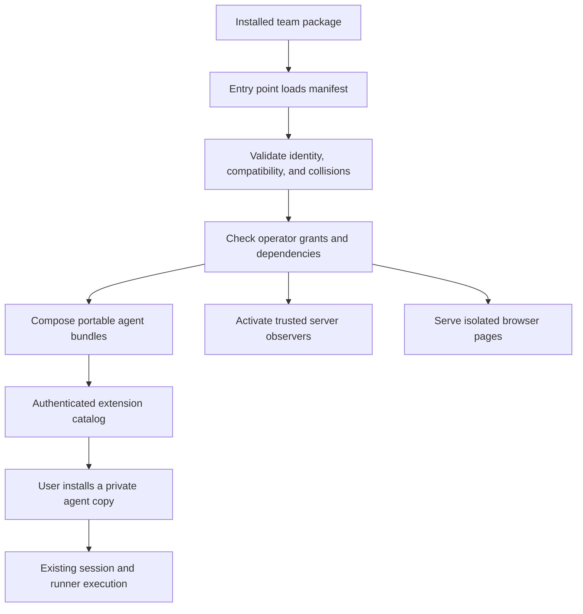

# Omnigent team extension guide

Omnigent extensions let teams publish agents, skills, tools, policy presets,
browser pages, and server observers as optional packages. A team owns its
package and releases; the server operator controls activation; users can
install approved agent templates into their own reusable-agent catalogs.

This guide describes the implementation introduced in
[PR #10912](https://github.com/omnigent-ai/omnigent/pull/10912), using extension
API version 1. Use a build containing that change to run the commands below.

## What a team can contribute

| Contribution | How it works | Example |
| --- | --- | --- |
| Agent pack | A portable agent directory containing its instructions, skills, tools, and MCP configuration. | An incident triage assistant. |
| Policy preset | A namespaced YAML policy mapping selected explicitly by an agent. | Ask for approval before OS tools run. |
| Browser page | A bundled page in an isolated iframe, reached through a namespaced route and optional sidebar link. | A team dashboard. |
| Server observer | An async activation function returning status and shutdown callbacks. | Log session status changes to an operator's existing telemetry. |

A team package can combine several contributions. For example, a reliability
team can ship a triage agent, an investigation skill, an observability MCP
configuration, and an approval preset in one release. The same package can
declare an optional dashboard or server observer.

Portable packs use Omnigent's existing agent format and policy engine. New
harness implementations continue through the separate
[harness plugin interface](../../designs/harness-plugin-interface.md).

## Architecture and ownership



The team owns the extension's source, tests, package dependencies, and release
version. Omnigent owns discovery, manifest validation, activation, catalogs,
and the supported callback and browser APIs. Server operators own the installed
distributions and configuration grants. Users own the agent copies they install.

The manifest is a lightweight Python value returned by an entry point in the
`omnigent.extensions` group. Its factory runs during discovery, before
activation grants are checked. Server implementations live behind a separate
entry point and are imported after activation checks pass.

## Try the reference package

From a source checkout with the implementation and its Python environment:

```sh
uv pip install --no-deps -e examples/extensions/incident-response
uv run --no-sync omni extensions list
uv run --no-sync omni extensions check acme.incident-response
```

The check should report:

```text
acme.incident-response: ok
agents: 1, policy presets: 1
Server entrypoint: validated without activation
```

Approve this package version in a disposable operator configuration, then start
the server with that file:

```sh
uv run --no-sync omni extensions enable acme.incident-response --config ./incident-server.yaml
uv run --no-sync omni server --config ./incident-server.yaml
```

The catalog at `GET /v1/extensions/acme.incident-response` should contain the
owner, the triage template, its version and SHA-256 digest, and the approval
preset. Requests use the server's normal authentication. See the
[reference package guide](../../examples/extensions/incident-response/README.md)
for export and execution steps. Running an agent requires the normal provider
credentials; checking or exporting a pack does not require a model call.

## Create a team package

Scaffold a project that can live in its own repository:

```sh
uv run --no-sync omni extensions init acme.triage --owner team-reliability --path ./acme-triage
uv pip install --no-deps -e ./acme-triage
uv run --no-sync omni extensions check acme.triage
```

`--no-deps` is appropriate here because this checkout already supplies
Omnigent. A separate environment should install the package with its normal
dependencies. The starter includes a manifest, an agent, a bundled skill, and
a package-conformance test. A fuller package can use this layout:

```text
acme-triage/
  pyproject.toml
  src/omnigent_acme_triage/
    __init__.py
    plugin.py
    hooks.py
    agents/assistant/
      config.yaml
      AGENTS.md
      skills/team-context/SKILL.md
      tools/python/incident_summary.py
      tools/mcp/observability.json
    policies/approvals.yaml
    dist/extension.js
    dist/extension.css
  tests/test_package.py
```

The `hooks.py`, policy, connector, tool, and browser files are optional; the
starter creates only the basic agent and skill. Include every declared asset
in the wheel's package data. Files present in an editable checkout can otherwise
be missing from the published wheel.

Register the manifest factory in `pyproject.toml`:

```toml
[project.entry-points."omnigent.extensions"]
extension = "omnigent_acme_triage.plugin:get_manifest"
```

The generated factory returns an `ExtensionManifest`. Its central fields are:

| Field | Meaning |
| --- | --- |
| `id` | Stable publisher-qualified identity, such as `acme.triage`. |
| `owner` | Accountable team; required for backend contributions. |
| `distribution`, `version` | Must match the installed Python distribution. |
| `requires_omnigent` | Supported Omnigent release range. |
| `extension_api` | Supported extension API major, currently `1`. |
| `dependencies` | Other extension IDs and acceptable version ranges. |
| `permissions` | Host capabilities requested by the package. |
| `agents`, `policies`, `pages`, `primary_navigation` | Declarative contributions. |
| `entrypoints.server` | Optional `module:activate` function for server lifecycle callbacks. |

Contribution IDs belong below the extension's namespace, such as
`acme.triage.assistant`. The agent's own `config.yaml` name follows normal
agent-name rules and is independent of that contribution ID. Manifest imports
should stay light; put runtime imports in the implementation module.

For full examples and validation rules, see the
[manifest reference](extension_manifest.md). For browser packaging and SDK calls,
see [browser extensions](browser_extensions.md).

## Enablement and compatibility

Backend contributions require an explicit grant in operator-owned server YAML:

```yaml
extensions:
  acme.incident-response:
    enabled: true
    version: "==0.1.0"
    permissions: [events.subscribe]
    required: false
    config:
      environment: development
```

The `enable` command writes the installed version as an exact pin and grants
all permissions declared by that manifest. Review the package before running
it. The YAML writer preserves unrelated settings, rewrites formatting, and
removes comments. A manually written `version` may use a compatible version range.

The configuration is a deployment-wide allowlist. An absent `extensions`
section preserves existing browser-only enablement; backend contributions stay
disabled. Once a mapping is present, only explicitly enabled entries activate.
`extensions: {}` disables all extensions. Project and session activation scopes
are not implemented.

Dependencies must already be installed, explicitly enabled, and version
compatible. They activate before dependents. Cycles, missing dependencies,
invalid resources, and ungranted permissions make affected contributions
unavailable. `required: true` makes an unavailable extension block server
startup; it is a startup gate, not a runtime approval rule.

## Using portable agents

The manager composes selected policy presets into the agent's normal
`guardrails.policies` configuration. A preset can come from the owning extension
or its declared dependency closure. Duplicate policy names fail validation,
and function policies must reference registered handlers.

The resulting bundle includes `omnigent-extension-lock.json`, recording the
extension and transitive dependency versions. Its archive metadata is normalized
so the same inputs produce the same digest. Environment placeholders remain
unexpanded during composition and export. Keep actual credentials in the
normal execution environment.

There are two ways to use a template:

1. **Export it for local execution.** Run `omni extensions export <extension-id>
   <contribution-id> --output agent.tar.gz`, extract the archive, and use
   `omni run <extracted-directory>`.
2. **Install a private copy through the server.** Fetch the extension catalog,
   take the template's `bundle_url`, replace its final `/bundle` with `/install`,
   and POST using the caller's normal authentication. The response is an agent
   object. It appears in `GET /v1/agents?scope=user` and can be selected through
   the existing new-session flow.

The server checks authentication, trusted Origin rules, and the requested
digest. Other users cannot retrieve the installed private copy through the
agent API. In local single-user mode, the copy belongs to the local user.

Portable packs carry their own files, so runners do not need the extension
distribution installed. Provider dependencies, model credentials, and reachable
MCP services still need their normal setup. Custom Python policy handlers must
also be available and registered where they are used.

## Server and browser execution

Server hooks receive an `ExtensionContext` containing extension identity,
version, a private configuration copy, and a logger. The async activation
function returns `ExtensionHooks`, with optional async status and shutdown
callbacks. The SDK context exposes no raw application stores.

`events.subscribe` authorizes session-status observations on the serving
replica. Notifications contain session ID, status, and an optional response ID.
They contain no transcript, credentials, or error detail. This is a deployment
observer, not a per-user browser subscription or a durable cluster event feed.

Each observer has a queue of up to 256 notifications. Activation and callbacks
have a five-second budget. A callback exception, timeout, or queue overflow
quarantines the extension and its dependents, removes their active catalog
contributions, and schedules cleanup. Shutdown runs in reverse dependency
order. A required extension that fails after startup is quarantined too.

Python packages and server hooks run with full server-process trust.
Permissions describe supported host operations; they do not sandbox Python.
Hooks must cooperate with async cancellation and avoid blocking the event loop.
Use separate processes or MCP services when a connector needs process isolation.

Browser pages run in an opaque-origin iframe. They use the permission-checked
browser SDK for supported navigation, session, project, theme, and storage
operations. They cannot use the host's authenticated transport directly.
Packaged pages need no host frontend rebuild, but their own bundles must be
built and included in the wheel. The browser SDK is currently a private
workspace package, so external distribution has that additional constraint.

## Upgrades, disabling, and troubleshooting

Publish a new package version, install it in the server environment, review its
requested permissions, update the version grant, and restart. Refresh clients
to load the new catalog. Install the new agent template when ready to adopt it.

Installed agent names include the contribution ID and extension version. A
new version creates a separate agent copy, preserving the old copy used by
existing sessions. Reinstalling changed contents under the same version follows
normal agent replacement behavior and can affect those sessions. Publish a new
version for a changed release. The version lock records provenance; it does not
prevent a package publisher from replacing a release.

To disable a package:

```sh
uv run --no-sync omni extensions disable acme.incident-response --config ./incident-server.yaml
```

Restart the server and refresh clients. Its active catalog entry, new downloads,
new installs, and observers disappear. Previously installed user-agent copies
remain owned by their users and can be removed through normal agent management.
Disabling contributions does not stop the package's manifest factory from
running during discovery; uninstall the distribution to remove that code.

| Symptom | Where to look |
| --- | --- |
| Package missing from local discovery | `omni extensions list`; confirm installation into the server's Python environment. |
| Invalid manifest, resource, or dependency | `omni extensions check <id>`. This checks the package without starting its server hooks. |
| Browser bundle missing | `omni extensions doctor <id>` and the wheel's package data. |
| Installed package absent from server catalog | Operator grants and `GET /v1/extensions/diagnostics`. |
| Observer disappeared after startup | Admin diagnostics and server logs for callback errors, timeouts, or overflow. |
| Old download URL returns 404 or install returns 409 | Refresh the catalog and use its current digest URL. |

Diagnostics are administrator-only in multi-user deployments. Optional failures
are isolated; an unavailable required extension prevents startup. Browser asset
failures suppress the affected pages and navigation.

## Contribution workflow and current limits

Develop in the team's repository, keep the manifest and package version aligned,
and run the generated conformance test. Validate a built wheel as well as an
editable checkout. Exercise activation and shutdown in a disposable server,
then verify export, authenticated install, and disablement. The
[reference E2E](../../tests/e2e/test_team_extension_pack_e2e.py) demonstrates this
journey with real CLI and server processes, without an LLM call.

The implementation provides package discovery, deployment activation, portable
agents and policy presets, existing browser pages, and status/shutdown hooks.
Several parts of the broader extension design remain future work:

- Project/session activation controls and a management UI.
- Automatic dependency installation, an extension marketplace, and upgrade UI.
- Additional UI slots such as settings sections, session actions, and tool-result renderers.
- General session launch, interrupt, resume, tool interception, and durable event hooks.
- Unified registration of harness, model, sandbox, and storage providers through
  this manifest.

Command records, `activation_events`, and navigation `when` expressions remain
reserved metadata. API major 1 evolves additively; breaking contracts require a
new major. Teams should depend on the documented extension APIs and validate
their supported Omnigent release range in package CI.
