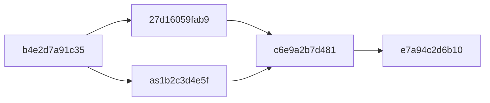

# Pending child schema rollout

This schema release creates storage for pending child reservations without
enabling child admission, execution, recovery, or cleanup. The application that
consumes it must ship in a later release. Both ORM bases share one physical
database by default, with one Alembic lineage. Deployments that configure a
separate `conversation_database_uri` keep conversation/AP tables in that second
database instead.

| Table | Owning store | Primary key | Retained state |
| --- | --- | --- | --- |
| `session_spawn_epochs` | Metadata | workspace, parent | Retry-fencing admission epoch |
| `session_spawns` | Metadata | workspace, creator runner, epoch, nonce | Reservation and cleanup receipt |
| `session_spawn_payloads` | Metadata | workspace, payload ID | Artifact ownership and delayed cleanup |
| `session_spawn_materializations` | Conversation/AP | workspace, child | Evidence that the reserved child was created |

Run Alembic only against the metadata database. In split-store deployments,
the schema release must also initialize the conversation database through the
existing `get_or_create_conversation_engine` path, which calls
`ConversationBase.metadata.create_all(checkfirst=True)` without Alembic. This
adds the materialization table alongside existing conversation tables. The
metadata migration also creates an unused compatibility copy of that table;
consumers use the copy in the conversation database. Do not apply the complete
metadata migration chain to a separate conversation database.

`ix_files_blob_reference(workspace_id, blob_key, id)` supports a bounded lookup
of shared artifact references. The consuming application must issue a separate
lookup by `(workspace_id, id)` with `blob_key IS NULL` for legacy rows. Wrapping
both columns in `COALESCE` does not use these equality paths.

## Revision compatibility

Keep the existing revision identities and parents. A database already stamped
at either pending-spawn revision can upgrade without recreating its tables or
discarding receipts.

## Deployment order

1. Obtain the independent database code-owner review required by
   [CONTRIBUTING.md](../CONTRIBUTING.md#database-migration-reviews).
2. Release this schema package while retaining the existing application
   behavior. Apply its migrations to a staging database first, then use the
   deployment's normal metadata migration process. For a split-store profile,
   start the schema-only release with the existing conversation database
   configured so its normal initialization creates the AP materialization
   table before any consumer deploys. No application backfill is needed.
3. Verify all four tables, the named file-reference index, and the recorded
   Alembic revision in the metadata database before releasing consumers. For
   split stores, also verify the materialization table in the conversation
   database and that its existing conversation data is unchanged; that
   database has no Alembic revision from this migration chain. Check index-build
   time and write-lock impact against representative file metadata on each
   deployed database engine; adding the index scans existing rows.
4. Release the consuming application only after the schema release is present.
   It owns lifecycle codes, input validation, artifact storage, admission,
   recovery, and bounded cleanup. Large create/input envelopes stay in the
   artifact store; the database stores UUID references. Stored file mappings
   and cleanup keys are capped at 7,200 and 3,600 bytes respectively.

The verification here executes SQLite migrations, query plans, and repeated
initialization of a separate existing conversation database. It verifies that
the latter retains conversation rows and materialization receipts without
adding metadata tables or an Alembic revision. PostgreSQL/MySQL DDL is compiled
only. This does not establish an online index-build plan or measured lock
duration on a deployed PostgreSQL/MySQL database.

## Rollback

Roll back consumer behavior to the schema-only release while leaving the new
schema installed. That release knows the new migration IDs and continues using
the existing tables. A binary from before the schema release may not recognize
those IDs, so it is not the application rollback target.

In the Alembic-managed metadata database, every new table is checked for retained
rows before any pending-spawn table is dropped. These downgrade operations do
not inspect or remove the separate AP database's materialization table. The
disposable SQLite round-trip tests target the common ancestor
`b4e2d7a91c35` to exercise removal; that target also reverses scheduled-task
kinds. A downgrade to `27d16059fab9` leaves the sibling `as1b2c3d4e5f` revision
and its tables installed, so it does not restore a pre-schema database.

Once consumers have used this schema, keep the receipts, materialization
markers, cleanup records, and blob-reference index during application rollback.
The table guard does not replace this deployment order. Retiring populated
tables or a used index requires the staged deprecation and observation process in
[Deployment practices](DATABASE_BEST_PRACTICES.md#deployment-practices).
