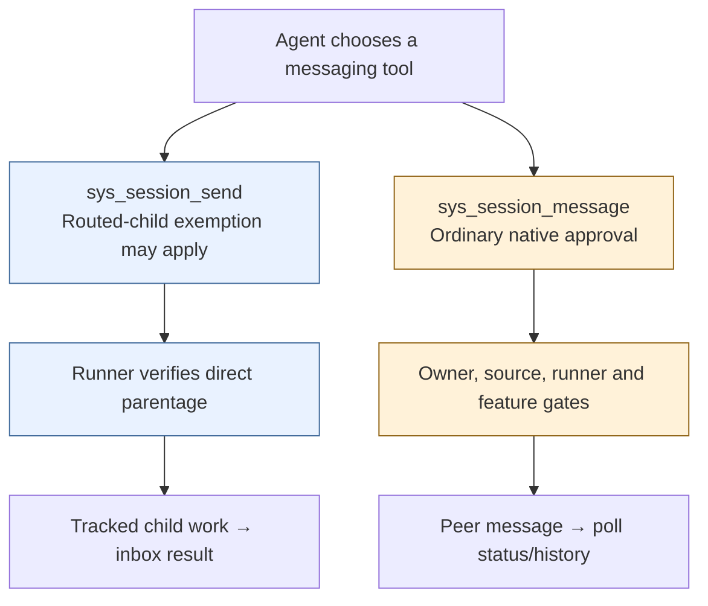

# Why child dispatch and peer messaging use separate tools

**Decision, 2026-10-30:** retain `sys_session_send` for tracked child work and
`sys_session_message` for ordinary messages to other owned sessions. Tool names
are part of the native approval contract. Internal helpers can still be shared.
This records the existing behavior on `main`; it changes no runtime permissions.

## Start with the user journey

| Request to manager A | Tool and example arguments | Result |
| --- | --- | --- |
| “Ask your child B to continue the review.” | `sys_session_send(session_id="bbbbbbbbbbbbbbbbbbbbbbbbbbbbbbbb", args="Continue the review.")` | Tracked child work; completion returns through A's inbox. |
| “Ask my independent session C to review the change.” | `sys_session_message(session_id="cccccccccccccccccccccccccccccccc", message="Review the change.")` | Ordinary queue/steering; A reads C's status/history for the answer. |

Creating C from A with `sys_session_create(placement="same_host")` or
`placement="managed"` does not make C a child. Its `created_by_session_id`
records origin; `parent_session_id` determines the child relationship.
Named child dispatch through `sys_session_send(agent=..., args=...)` remains
available too. The table describes the intended choice, not a new restriction
on which owned destinations the peer-message tool can address.

## The approval boundary

Some Smart Routing configurations pre-approve `sys_session_send` so a routed
child can receive work without an unattended permission prompt. Claude receives
the tool name in `--allowedTools`; Codex receives a per-tool
`approval_mode = "approve"`. Neither framework exemption names
`sys_session_message`. These entries do not inspect the destination's parentage.

**Server authorization and native approval are independent checks.** Ownership
answers whether this caller may address the session. Native approval applies the
user's harness permissions to this tool invocation. A server-policy ALLOW leaves
native permission handling in place; it does not itself authorize skipping it.
“Ordinary approval” can mean allow, ask, or deny under the user's settings; it
does not promise a prompt on every message. SDK harness policies are separate
from the native configuration illustrated here.

If `sys_session_send` gains peer delivery while retaining that name's blanket
exemption, automatic child permission silently covers peer writes too. For
example, Pat's private manager could send text into Pat's independent session C
shared with Bryan. The server's owner/source checks can legitimately pass, and
Bryan can see the delivered text. The regression is the missing native decision,
not a claim that ownership checks stopped working or that a shared sender is
allowed. Separating names preserves the scope of the framework exemption; it is
not a sandbox against agents with unrestricted shell or user-granted access.

## Alternatives and tradeoffs

| Choice | Child follow-ups | Peer approval | Cost |
| --- | --- | --- | --- |
| **Keep separate tools** | Preserve the existing routed-child exemption | Preserve ordinary native rules | Agents must choose the appropriate tool; retain clear descriptions/examples. |
| One tool, remove its blanket exemption | Follow ordinary native rules too; may prompt or refuse unattended work | Preserved | Small implementation, but changes child workflow behavior. |
| One tool, approve according to destination | Can preserve automatic child follow-ups | Requires a verified destination-aware gate | More approval plumbing and integration checks across harnesses. |

The second option can still launch an initial routed child task automatically
through the existing `sys_session_create(message=...)` path. Its tradeoff concerns
later sends. Keeping one tool **and** the existing blanket exemption is rejected:
the server peer gate does not repair the native approval change.

We choose separate tools because their approval scopes already exist and their
completion behavior differs. Keeping the existing names also avoids migrating
`sys_session_message` callers and tool-name policies from v0.20.0. Shared HTTP
transport or implementation helpers do not require sharing a model-facing name.
This decision does not change creation approvals, sharing eligibility, reply
delivery, database schema, or release flags.

## Evidence and when to reconsider

The approval finding came from [review of the proposed unification](https://github.com/omnigent-ai/omnigent/pull/11802#issuecomment-6521147539).
It was a source-based finding, not a reproduced exploit. Source references below
were checked against `695db899f` on `main`.

| Contract | Source |
| --- | --- |
| Child-only by-ID dispatch | [`_send_to_existing_session`](../omnigent/runner/tool_dispatch.py) |
| Claude routed-tool exemption | [`_ROUTED_SPAWN_ALLOWED_TOOLS`](../omnigent/runner/native/orchestration.py) |
| Codex routed-tool exemption | [`framework_approved_tools`](../omnigent/harnesses/codex_native/app_server.py) |
| Server ALLOW leaves native consent independent | [`evaluation_response_to_hook_output`](../omnigent/native/native_policy_hook.py) |
| Peer delivery and server authorization | [Peer helper](../omnigent/runner/session_message.py), [server gate](../omnigent/server/session_orchestration.py) |

The natural-language smoke on the unification branch initially failed because
Codex chose standalone CLI/server setup to **create** a top-level worker. A
guidance correction passed one fresh trial of each Claude/Codex × child/top-level
case. That result supports clearer creation guidance; it does not establish a
problem choosing between messaging tools or validate native consent denial.

Reconsider unification when we accept ordinary approvals for child follow-ups,
or have verified destination-aware approval. Before expanding an automatically
approved tool's scope, checks must cover native Chat and terminal paths: denied
peer consent produces no destination event; child completion/wake still works;
lookup failures never grant approval; and the actual generated Claude/Codex
configuration matches the intended scope. Existing [Claude launch](../tests/runner/test_app_claude_native_launch_args.py),
[Codex profile](../tests/harnesses/codex_native/app_server/test_session_profiles.py),
and [dispatch](../tests/runner/test_runner_dispatch.py) scenarios are the starting
points, not proof of an unimplemented approval mechanism.
