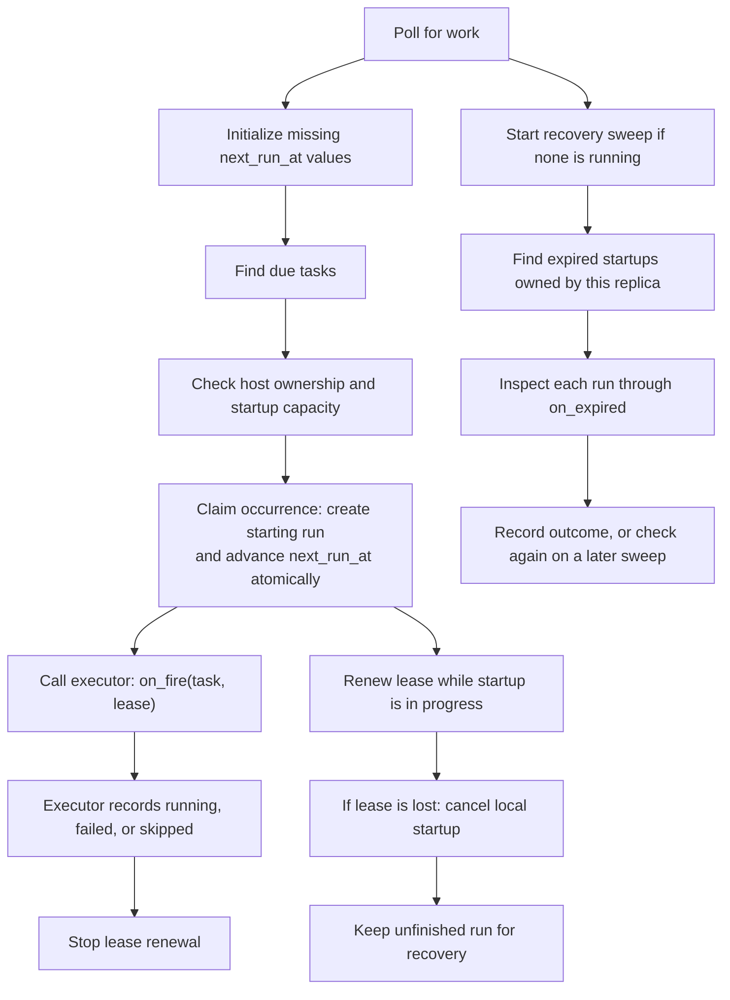

# Persistent task scheduling

`PersistentTaskScheduler` reads due tasks from the database and starts each
occurrence once across server replicas. It also checks interrupted startups so a
server crash does not leave a run in `starting` forever.

The `automations_v2` flag selects this scheduler. It defaults to off, which keeps
the existing in-memory timers.

## Starting a run

Each poll fills in missing `next_run_at` values, then finds active tasks that are
due. For each page of due tasks, the scheduler asks once which of their hosts this
replica owns, then checks startup capacity for each owned task. The store creates a
`starting` run and moves `next_run_at` forward in one transaction. This is the
**claim**: if another replica already claimed the occurrence or the task changed,
this attempt does not start it.

The scheduler passes the claimed run to an executor through `on_fire(task, lease)`.
The executor prepares the session and launches the work. A heartbeat keeps the
startup lease alive until the executor records `running`, `failed`, or `skipped`.
The lease covers startup; it does not last for the whole agent turn.



## Run now

`POST /v1/scheduled-tasks/{id}/run` calls `run_now(task)`. It records a pending
`scheduled` run with its own `manual:<id>` trigger key, and derives the run's host
ID like any occurrence. If this replica owns that host and has startup capacity,
it claims the run and starts it right away. Otherwise the host's owner claims it
on a later poll. Each poll reads one page (`batch_size`) of pending runs, resuming
where the previous poll stopped and wrapping at the end, so requests for other
replicas' hosts cost each poll at most one page. The claim moves the run to `starting` with a lease, so Run now
gets the same executor, heartbeats and recovery as a scheduled occurrence.

Run now works on paused tasks and never moves `next_run_at`. Each request is its
own run and may overlap a scheduled one. A pending run whose task is deleted
before it is claimed is recorded as `skipped`, then purged with the task. If the
task's target changes first, the claim moves the run to the new host ID and
leaves it for that host's owner. Once a request is recorded, the route returns
202 even if starting it here fails; a later poll starts it.

After downtime, an overdue task runs once and then moves to its next future time.
For example, an hourly task due at 9 AM runs once when the server returns at
12:30 PM, then again at 1 PM. Missed hours are not replayed. A task with no saved
`next_run_at` starts with its next future occurrence instead.

Creating a task or editing its schedule, time zone, or state updates `next_run_at`.
Editing its prompt does not. Recurrence intervals keep their creation-date
alignment, and `COUNT` counts occurrences strictly after creation. Invalid
schedules are paused; temporary errors or schedule-search limits leave them for
a later poll. Initialization reads one page per poll so one bad row does not
block other tasks.

The executor must await its startup work and respect cancellation. Stopping the
scheduler cancels local startups and prevents further polling until it is started
again. A database request already running in a worker thread can still commit:
a claim may be left for recovery, or a renewal may delay recovery until its new
deadline. Lease writes stay serialized until their database calls finish and
update the local run snapshot, even if their callers were cancelled. Writes still
waiting for the lease lock are cancelled without making a database call.

Constructing the scheduler enables persistent dispatch on its shared store. Do
this before serving requests, using the application's scheduler mode. Stopping
the scheduler stops its work but does not switch the store back to legacy mode.
Call `start()` and `stop()` sequentially, awaiting each before calling the next.

Startup recovery inspects unfinished `starting` runs after their leases expire.
An executor error after recording `running` does not move the run back into
startup recovery. Error logs include the last locally recorded run status.
Unexpected database-write failures are logged even if the caller was cancelled;
expected lease loss does not produce an extra error traceback.

## Recovering an interrupted startup

A lease is a deadline stored in `lease_expires_at`. Only the server actively
preparing a run renews it. Temporary renewal errors can be retried while the last
confirmed lease is valid. Once it expires, that server stops local startup work.
A different server does not renew the lease just because it now owns the host.

Recovery runs separately from due-task polling. It finds expired `starting` runs,
checks host ownership, stops any local startup still active for the run, and asks
`on_expired(run)` what happened. Expiry alone does not prove the server died or
that the prompt was never sent. Recovery must inspect the session and resources
before deciding what to preserve or clean up. It never sends another prompt.

Each server runs one recovery pass at a time. Each pass inspects at most
`batch_size` expired runs, then removes a bounded page of eligible history for
deleted tasks. The next pass continues where it left off. The scan keeps its
original expiry cutoff until it reaches the end, then starts over to revisit
uncertain outcomes and include newly expired leases. Slow recovery does not block
new runs, and deletion cleanup gets a turn between recovery pages.

A failed deletion is logged and skipped until the next scan so other tasks can
be cleaned up. Deleting a task immediately hides it and prevents new runs;
unfinished claimed runs remain until their result or cleanup is recorded.

Shutdown cancels and waits for local startup and recovery work. Unfinished runs
remain in the database for a later recovery sweep.

## Execution and recovery callbacks

Give each application its own scheduled-task store instance. `create_app()` sets
that object's scheduling mode; sharing it lets one app overwrite another's mode.
Separate instances can share a database, with all replicas using the same mode.

A deployment can override these through `ScheduledTaskDispatchHooks`, passed to
`create_app(scheduled_task_dispatch=...)`. Omitted hooks use the defaults:

| Callback | Responsibility | Default |
| --- | --- | --- |
| `on_fire(task, lease)` | Start the already-claimed run and record its startup outcome. | The built-in executor |
| `on_expired(run)` | Inspect an interrupted startup and preserve delivered work or clean up abandoned resources. | The built-in executor |
| `owned_hosts(keys)` | Return the subset of host keys this replica owns, so it starts or recovers only that work. | Every key |
| `fire_identity(task)` | Async context manager the built-in executor enters to act as the task's owner, e.g. by assuming a stored delegation. | None |

Replace `on_fire` and `on_expired` together or not at all. `fire_identity` is
only for the built-in executor; a replacement executor acts as the owner itself.

Each key is the occurrence's host ID, or the workspace ID as a decimal string for
a task with no host. Host IDs are bare lowercase 32-character hex, the same string
a host or sandbox sends as its routing key. The scheduler calls `owned_hosts` once
per page of due tasks, of Run now requests, and of expired startups, with each key
listed once. If the call raises, or exceeds `recovery_seconds` during recovery, the
replica owns none of that page. Due tasks it skips are checked again on the next
poll; skipped Run now requests and expired startups are checked again once their
scan starts over.
`owned_hosts` is awaited during due-task polling, so it must return promptly and
respect cancellation.

The executor uses the existing `lease.run`, rather than inserting another run.
It calls `lease.check()` before external actions and `lease.attach_session(id)`
after creating the session, so recovery can find it. When startup is safely handed
off, it calls `lease.finish("running")`. A known failure uses `"failed"` after
cleanup; an intentional skip uses `"skipped"`. Uncertain outcomes stay available
for recovery.

For an executor that saves pending prompts, a safe handoff requires both the saved
prompt and a persisted host binding that lets the host's server continue delivery.
Submitting a sandbox-create request alone is not enough. These are responsibilities
of the supplied executor; the scheduler itself does not provision sandboxes or
deliver prompts. The executor also rechecks the owner's authorization, because a
valid lease is not permission to act as that user.

The recovery callback returns one of four results:

| Result | Meaning |
| --- | --- |
| `"running"` | Startup was successfully handed off; preserve the work. |
| `"succeeded"` | The prompt was delivered and the session's turn already finished. The completion hook only updates `running` runs, so recovery records this itself. |
| `"failed"` | Startup cannot continue and cleanup has completed. |
| `None`, or an exception | The outcome or cleanup is uncertain; check again on a later sweep. |

The store accepts a recovery result only if the run still has the same expired
lease. Two replicas can still call the callback for the same run, so resource
cleanup must be safe to repeat and run concurrently. Lease checks use server
clocks, which must stay synchronized. Callbacks must respect cancellation and
keep their work inside the awaited call; cancellation cannot undo an external
request that was already accepted.

## The built-in executor

`ClaimedRunExecutor` in [fire.py](fire.py) runs the same steps as a legacy fire:
validate the task, create the session, grant the owner, then launch. It records
each step on the claimed run instead of inserting a new one:

1. It renews the lease before creating the session and before launching.
2. It attaches the session to the run right after creating it.
3. For a connected host, it records `running` once the prompt is sent.
4. For a managed sandbox, it saves the prompt, then starts the sandbox under the
   run's `host_id`, so the sandbox's connection routes to the replica that owns
   that ID. It records `running` once the session row stores the sandbox's
   host. Until then no other replica can finish the launch or deliver the
   prompt. A sandbox that has not bound within 12 minutes is abandoned: the
   saved prompt fails, the launch is cancelled, the sandbox is torn down, and
   the run fails with `sandbox_registration_timeout`.
5. A known failure records `failed` with the same `error_code` the legacy path
   uses, e.g. `host_offline` or `launch_failed`. A managed launch records its
   stage instead: `sandbox_create_failed` before the host binds, or
   `runner_start_failed` after. An unsupported target records `skipped`.

It also stamps `last_run_at` and `last_run_conversation_id` on the task, as legacy
fires do. Both paths create sessions with the same helper, so per-task session
settings such as the model override apply to both.

The executor runs under the owner's account and host-owner scopes, as legacy
fires do. When `fire_identity` is set, it enters that first. If entering raises
`FireIdentityRevoked`, the run fails with `reauthorization_required` and no
session is created. A deleted owner disables the task with `owner_deleted`
instead. Any other error is treated as temporary: the run fails with
`owner_identity_unavailable`, and the next occurrence tries again.

Recovery enters the same identity before inspecting a session. A temporary
error leaves the run for a later sweep. `FireIdentityRevoked` records `failed`
without inspecting or cleaning up, so a sandbox is left to the provider's
lifetime cap.

Tasks a fire starts, such as the sandbox launch, copy the identity's context
variables and can outlive the fire. The identity's `__aexit__` must not revoke
credentials those tasks still use.

Recovery decides from the saved session and never sends a prompt. It treats a
run as a managed sandbox run when its `host_id` is the sandbox ID derived from
its task and trigger key. That check uses the run rather than the task's current
target, which may have been edited since the claim.

| Saved state | Result |
| --- | --- |
| No session on the run | `failed`: launch starts only after the session is attached. |
| Connected host, neither the prompt nor agent output in the transcript, and no active turn | `failed`: the prompt was never sent. |
| Connected host, prompt delivered | `failed` if the session failed. `succeeded` if it is idle and its newest output is the agent's reply. Otherwise `running`. |
| Managed sandbox whose launch already failed | Tear down any sandbox registered under the run's host ID, then `failed`. |
| Managed sandbox with its host bound | `running` while the prompt is pending, otherwise the outcome of a delivered prompt as above. |
| Managed sandbox still provisioning on this server | `None`: check again on a later sweep. |
| Managed sandbox with no host bound and no local launch, within the shutdown drain after the lease expired | `None`: a replica that lost the lease while shutting down may still bind the sandbox (`shutdown_drain_s`). |
| Managed sandbox with no host bound and no local launch, after that | Tear down the sandbox registered under the run's host ID, fail the saved prompt, then `failed`. |
| Session deleted | Tear down any sandbox for a managed run, then `failed`. |

An `idle` status alone does not mean the turn finished: a session can be idle
with its prompt saved but never run. Runner bookkeeping such as `resource_event`
items does not count as evidence either. Teardown only ever applies to
server-managed sandbox hosts. It is safe to repeat, so two replicas can recover
the same run.

## Timing and capacity

These are the defaults in the server YAML configuration:

```yaml
scheduled_task_scheduler:
  startup_retry_seconds: 30  # Delay before retrying failed scheduler startup, in either mode
  poll_seconds: 30       # Time between checks for due tasks and expired startups
  renewal_seconds: 30    # Time between startup heartbeats
  lease_seconds: 120     # Lease duration after a successful renewal
  recovery_seconds: 30   # Timeout for inspecting and recovering one run
  batch_size: 100        # Maximum rows per database page
  max_startups: 100      # Concurrent startups per server, not active agent turns
```

Omit the section or individual settings to use defaults; an empty section also
uses defaults. For the CLI, pass the YAML file with `omnigent server -c path/to/config.yaml`.
Application wrappers can pass `server_config`; otherwise `create_app()` reads the
file selected by `OMNIGENT_CONFIG`. Wrappers can also
supply `scheduled_task_scheduler_config=ScheduledTaskSchedulerConfig(...)` to
replace the YAML scheduler settings.

Settings take effect at startup. Values must be positive and finite; lease seconds
and capacities must be whole numbers. Renewal must be more frequent than expiry.
Invalid settings fail startup when the flag is on. With the flag off, only
`startup_retry_seconds` is read and validated; other scheduler settings are ignored.

## Switching schedulers

Set `OMNIGENT_FEATURES=automations_v2` and restart all scheduler replicas together.
The application requires a compatible store. Without `scheduled_task_dispatch`,
it uses the built-in executor and owns every host, which suits a single replica.
A multi-replica deployment passes its own `owned_hosts`.

To switch back, stop new startups and let existing ones finish or recover. Then
set `OMNIGENT_FEATURES=-automations_v2` and restart all replicas. Legacy startup
clears saved `next_run_at` values before creating future timers, and records
pending Run now requests as `skipped` (`dispatch_disabled`). Task definitions,
run history, and running agent sessions are retained. Clearing the saved times
prevents a later re-enable from replaying occurrences handled by the old timers.
If clearing or startup fails, it retries after `startup_retry_seconds` (default 30).
Legacy timers become available to routes after cursor reset, before task loading;
changes made during loading take precedence over the database snapshot. A failed
load clears partial timers before retrying. Persistent-mode task routes return
saved `next_run_at` values even when the scheduler is unavailable.

The startup retry interval applies to failures in either scheduler's `start()`.
Persistent startup normally just launches the polling loop; database failures
inside that loop retry at `poll_seconds`, not `startup_retry_seconds`.
Database reads and cursor resets run off the event loop. Shutdown stops scheduling
before the sandbox reaper and waits for an ongoing cursor reset to finish, so a
slow database write can delay shutdown. Shutdown does not wait for a pending
legacy task read: its worker thread may keep a connection until the query finishes,
but its result cannot arm timers after shutdown. Process exit may still wait for
the thread pool to finish. Configure database/driver timeouts to bound that wait.

All replicas sharing a database must use the same mode, because legacy timers do
not claim occurrences. Changing the environment of a running server does not
switch its scheduler. The flag is exposed through `/v1/info`; per-workspace access
controls are separate.

The store supports PostgreSQL, MySQL, CockroachDB, and SQLite. Cloudflare D1 cannot
provide the transaction needed to create a run and advance its schedule together.

## Debug-log events

The scheduler writes structured events with `debug_event`, like the rest of the
server. When the debug-log sink is enabled, they reach the same table as session
lifecycle events, so dashboards compute scheduler KPIs with SQL. Claims, sessions,
startup outcomes (including failures), and recovery results are logged at INFO; only
operation failures, recovery timeouts, and recovery errors are WARNING or higher.
The metrics therefore need an INFO log level. Every run event includes `task_id`,
`run_id`, `task_workspace_id`, and `scheduled_at`; `claim_skipped` is an occurrence
event with no `run_id`. Once a session exists, the row's `session_id` links the run
to its session events.

| Event | Logged when | Extra attributes |
| --- | --- | --- |
| `scheduled_run_claimed` | This server claimed a due occurrence or a Run now request. | `target`, `host_id`, `claim_delay_seconds` |
| `scheduled_run_claim_skipped` | The claim did not apply: the occurrence was already claimed, or the task was edited, paused, or deleted after it was listed. | `target` (no run) |
| `scheduled_run_session_attached` | The executor recorded the fired session with `lease.attach_session()`, or changed it. | `target`, `session_delay_seconds` |
| `scheduled_run_startup_ended` | Startup ended on the executing server. | `target`, `outcome`, `error_code`, `prompt_delay_seconds` |
| `scheduled_run_recovered` | Recovery inspected an expired startup. | `outcome` |
| `scheduled_task_operation_failed` | An operation failed and will be retried. | `operation` |

`startup_ended` outcomes are `running`, `failed`, or `skipped` from the executor, or
`lease_lost`, `interrupted`, `unfinished`, or `cancelled` when startup ended without
a result. Recovery outcomes are `running`, `succeeded`, `failed`, `uncertain`, `superseded` (the
run was no longer the expired startup recovery inspected), `timeout`, or `error`.
Operations are `poll`, `initialize`, `claim`, `recovery`, `cleanup`, and
`lease_renewal`. `claim` failures and single-task `initialize` failures include
`task_id` and `task_workspace_id`; a failed scan or ownership lookup has neither.
Delays are seconds from the scheduled time to when the scheduler was asked to record
the step, so database write time is excluded.

Outcomes are logged when the database write commits, so a write that finishes
after its caller was cancelled or timed out still logs its real result. A run can
therefore log `timeout` and later `running` or `error`. Recovery logs `uncertain`
on every sweep that cannot decide, so expect several per run.

During shutdown the scheduler does not wait for in-flight writes, so a run whose
`running` write committed then may never log `running`, slightly understating fire
success. A startup cancelled before its first step logs no `startup_ended`;
recovery logs it later.

The sink stores attribute values as strings; cast delays before computing
percentiles. Attributes whose value is `None`, such as `error_code` or
`prompt_delay_seconds` on a non-`running` outcome, are omitted rather than stored.

The design's success metrics come from these events:

| Success metric | Calculation |
| --- | --- |
| Fire success rate | Distinct `run_id`s whose `startup_ended` outcome is `running`, or whose `recovered` outcome is `running` or `succeeded`, ÷ distinct claimed `run_id`s, excluding runs the executor ended as `skipped`. Occurrences missed during downtime are never claimed. |
| Duplicate fires | Claimed `run_id`s per `(task_workspace_id, task_id, scheduled_at)`. The database's unique key keeps this at one, so the query only confirms that constraint holds. `claim_skipped` also counts edited, paused, and deleted tasks, so it is not a duplicate count. |
| Fire delay | p90 of `session_delay_seconds`. The executor must call `lease.attach_session()`; a session passed only to `finish()` produces no fire-delay event. To exclude sandbox boot time, it must attach the session before waiting for the sandbox. |
| Time to prompt | `prompt_delay_seconds` on `running` outcomes, by `target`. |
| Fires per day, Arclet vs. pinned host | Claimed runs by `target`. Active tasks and owners come from `scheduled_tasks`. |

Failure stages come from the executor's `error_code`.

## Code

[dispatch_scheduler.py](dispatch_scheduler.py) coordinates polling, heartbeats, and
recovery. [fire.py](fire.py) holds the fire steps shared by both schedulers and the
built-in executor. [schedule.py](schedule.py) calculates occurrence times and identities.
The [store](../../stores/scheduled_task_store/sqlalchemy_store.py) implements the
atomic database operations. [config.py](config.py) validates timing and capacity.
