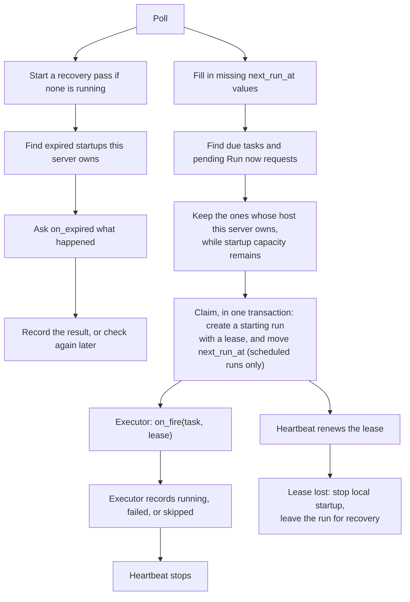
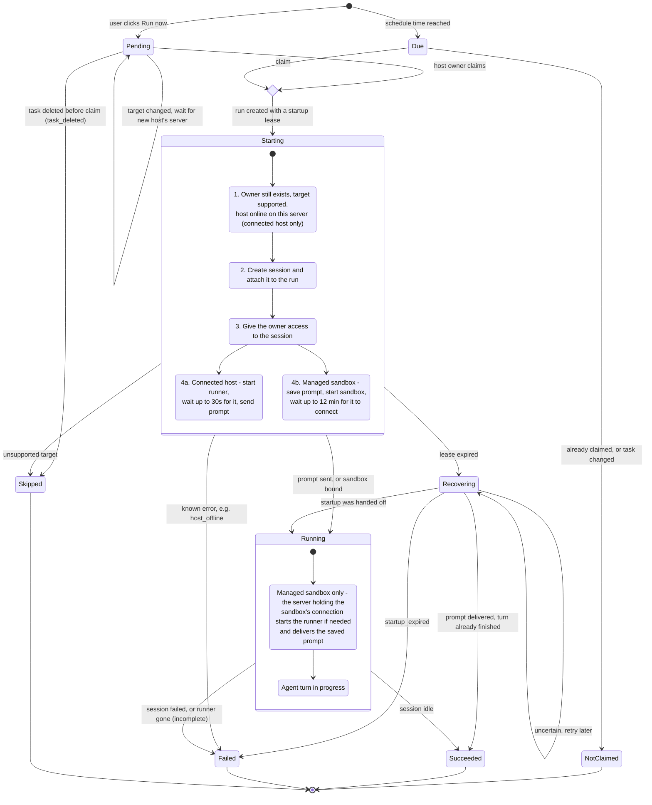
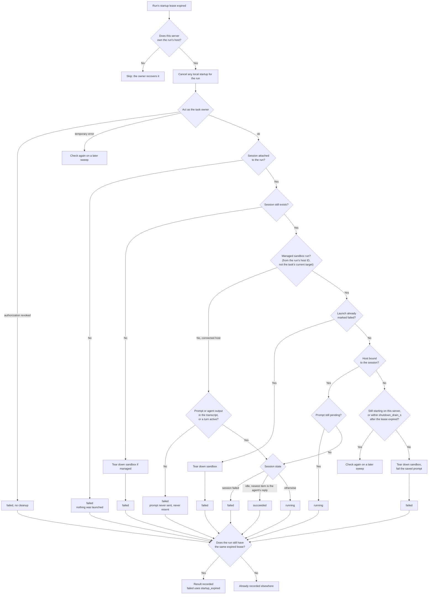

# Persistent task scheduling

Scheduled tasks ("automations") run a saved prompt on a recurring schedule or on
demand. `PersistentTaskScheduler` keeps the schedule in the database, so every
occurrence runs once even with several server replicas, and an occurrence
interrupted by a crash is still resolved instead of staying in `starting` forever.

The `automations_v2` feature flag turns this scheduler on. It is off by default,
and the server then uses the older in-memory timers ("legacy timers").

Terms used below:

| Term | Meaning |
| --- | --- |
| Occurrence | One scheduled time of a task, or one Run now request. |
| Run | The database row recording one occurrence: `scheduled`, `starting`, `running`, `succeeded`, `failed`, or `skipped`. |
| Claim | The database write that turns an occurrence into a `starting` run. Only one server can claim an occurrence. |
| Startup | The work between the claim and handing the prompt to the agent. |
| Lease | A deadline on a `starting` run (`lease_expires_at`). The server doing the startup keeps renewing it. |
| Recovery | The background job that decides what happened to a run whose lease ran out. |
| Executor | The code that does the startup. The built-in one is `ClaimedRunExecutor`. |
| Host owner | The replica responsible for a host, chosen by `owned_hosts`. It claims and recovers that host's runs. |

## How a poll works

Every `poll_seconds`, each server does the following:

1. Starts a recovery pass in the background, unless one is still running.
2. Fills in a missing `next_run_at` for up to one page of tasks.
3. Finds active tasks that are due. For each page, it asks once which hosts it
   owns, and claims the owned tasks while it has startup capacity.
4. Reads one page of pending Run now requests and claims the ones it owns.

The claim creates a `starting` run with a lease and, for a scheduled occurrence,
moves the task's `next_run_at` forward, in one transaction. If another replica already claimed the
occurrence, or the task was edited, paused or deleted after it was listed, the
claim does not apply and nothing starts.

After a claim, the scheduler calls the executor with `on_fire(task, lease)`. A
heartbeat renews the lease until the executor records `running`, `failed`, or
`skipped`. The lease only covers startup, not the whole agent turn.



## When tasks run

- **Saved next time.** Creating a task, or changing its schedule, time zone, or
  state, recalculates `next_run_at`. Changing the prompt does not. A task without
  a saved `next_run_at` gets its next future occurrence on a later poll; one page
  of such tasks is filled in per poll, so one bad row does not block the rest.
- **Downtime.** An overdue task runs once, then moves to its next future time.
  Missed occurrences are not replayed. For example, an hourly task due at 9 AM
  runs once when the server comes back at 12:30 PM, then again at 1 PM.
- **Recurrence rules.** Intervals stay aligned to the task's creation time, and
  `COUNT` counts only occurrences after creation. An unknown time zone falls back
  to UTC.
- **Finished schedules.** When a schedule has no future occurrence left (its
  `UNTIL` or `COUNT` is used up), the task becomes `completed`. This happens on
  the final claim, on creation, or when a missing `next_run_at` is filled in.
  Changing the schedule or time zone, or resuming the task, reopens it if a future
  occurrence exists. Legacy timers never mark a task `completed`.
- **Bad schedules.** An invalid schedule pauses the task. A temporary error, or a
  schedule that takes too long to search, is left for a later poll.

## Run now

`POST /v1/scheduled-tasks/{id}/run` calls `run_now(task)`, which records a
`scheduled` run with its own `manual:<id>` trigger key. Its host ID is worked out
the same way as for a scheduled occurrence.

- If this server owns that host and has startup capacity, it claims and starts the
  run right away. Otherwise the host's owner claims it on a later poll.
- Each poll reads one page (`batch_size`) of pending requests, carrying on where
  the last poll stopped and wrapping at the end. Requests for other replicas'
  hosts therefore cost each poll at most one page.
- Once claimed, a Run now run gets the same executor, heartbeat, and recovery as
  a scheduled one.
- Run now also works on paused tasks, and never moves `next_run_at`. Each request
  is its own run and can overlap a scheduled run.
- If the task is deleted before the claim, the run is recorded as `skipped`
  (`task_deleted`) and purged with the task. If the task's target changes first,
  the claim moves the run to the new host ID and leaves it for that host's owner.
- Once the request is recorded, the route returns 202, even if starting it here
  fails; a later poll starts it. It returns 503 when the scheduler is not running.

## Startup leases

Only the server doing a startup renews its lease. If a renewal fails, it keeps
retrying while the last confirmed lease is still valid. Once the lease expires,
the store rejects that server's writes, and the server stops its local startup
work. Becoming a host's new owner does not let another server renew the lease.

Rules for executors and callers:

- The executor must await its startup work and respect cancellation.
- `start()` and `stop()` must be called one at a time, awaiting each. Stopping
  cancels local startups and stops polling until the scheduler is started again.
- A database call already running in a worker thread can still commit after a
  stop or cancellation. A claim may then be left for recovery, or a renewal may
  push recovery back to its new deadline.
- Lease writes for a run happen one at a time, and each finishes updating the
  local copy of the run even if its caller was cancelled. Writes still waiting
  their turn are cancelled without touching the database.
- An executor error after `running` was recorded does not send the run back to
  recovery. Error logs include the last run status this server recorded.
  Unexpected write failures are logged even if the caller was cancelled; an
  expected lease loss does not log an extra traceback.

Creating the scheduler switches its store to persistent mode. Do this before
serving requests, based on the app's scheduler mode. Stopping the scheduler does
not switch the store back.

## Recovering an interrupted startup

A lease running out does not prove the server died, or that the prompt was never
sent. Recovery therefore runs separately from polling and looks at the evidence
before deciding:

1. It finds `starting` runs whose lease has expired.
2. It keeps the ones whose host this server owns.
3. It cancels any local startup still running for the run.
4. It asks `on_expired(run)` what happened, and records the answer.

Recovery never sends the prompt again.

Each server runs one recovery pass at a time:

- A pass inspects at most `batch_size` expired runs, then removes one page of
  leftover history for deleted tasks. The next pass carries on from there.
- A scan keeps the expiry cutoff it started with until it reaches the end. It then
  starts over, which picks up newly expired leases and revisits runs it could not
  decide.
- Slow recovery does not delay new runs, and deleted-task cleanup gets a turn
  between recovery pages.

Deleting a task hides it and stops new runs at once. Its unfinished claimed runs
stay until their result or cleanup is recorded. If cleanup for one deleted task
fails, it is logged and skipped until the next scan, so other tasks still get
cleaned up.

On shutdown, the server cancels its local startups and recovery work and waits for
them. Unfinished runs stay in the database for a later recovery pass.

## The built-in executor

`ClaimedRunExecutor` in [fire.py](fire.py) runs the same steps as a legacy fire,
but records each one on the claimed run instead of inserting a new run:

1. **Check.** The owner still exists, the target is supported, and for a connected
   host, the host is online on this server.
2. **Create the session.** It renews the lease first, then attaches the session to
   the run right away, so recovery can find it.
3. **Grant the owner** access to the session.
4. **Launch.** It renews the lease again, then:
   - **Connected host:** starts a runner on the host, waits up to 30 seconds for
     it to connect, sends the prompt, and records `running`.
   - **Managed sandbox:** saves the prompt in the session, then starts a sandbox
     under the run's `host_id`, so the sandbox connects to the replica that owns
     that ID. It records `running` once the session stores the sandbox's host;
     until then, no other replica can finish the launch or deliver the prompt.
     The server holding the sandbox's connection then delivers the saved prompt.
     A sandbox that has not connected within 12 minutes is abandoned: the saved
     prompt fails, the launch is cancelled, the sandbox is torn down, and the run
     fails with `sandbox_registration_timeout`.

Known failures record `failed` with the same `error_code` as legacy fires, such as
`host_offline` or `launch_failed`. A managed launch records where it failed instead:
`sandbox_create_failed` before the host connects, or `runner_start_failed` after.
An unsupported target records `skipped`.

Like legacy fires, it stamps `last_run_at` and `last_run_conversation_id` on the
task. Both paths create sessions with the same helper, so per-task settings such as
the model override apply to both.

### Acting as the owner

The executor runs under the owner's account and host-owner scopes, like legacy
fires. If `fire_identity` is set, it enters that first:

| When entering the identity… | Result |
| --- | --- |
| Raises `FireIdentityRevoked` | The run fails with `reauthorization_required`, and no session is created. If the owner was deleted, the task is disabled with `owner_deleted` instead. |
| Raises any other error | Treated as temporary: the run fails with `owner_identity_unavailable`, and the next occurrence tries again. |

Recovery enters the same identity before inspecting a session. A temporary error
leaves the run for a later pass. `FireIdentityRevoked` records `failed` without
inspecting or cleaning up, so a sandbox is left to the provider's lifetime cap.

Work a fire starts in the background, such as the sandbox launch, copies the
identity's context variables and can outlive the fire. The identity's `__aexit__`
must not revoke credentials that work still uses.

### Recovery evidence

The built-in recovery decides from the saved session, as shown in
[How recovery decides](#how-recovery-decides). A few rules keep it from guessing
wrong:

- A run counts as a managed sandbox run when its `host_id` is the sandbox ID
  derived from its task and trigger key. This uses the run, not the task's current
  target, which may have been edited since the claim.
- An `idle` session alone does not mean the turn finished: a session can be idle
  with its prompt saved but never run. Runner bookkeeping such as `resource_event`
  items does not count as evidence either.
- Teardown only applies to server-managed sandbox hosts, and is safe to repeat, so
  two replicas can recover the same run.

## Run states and interruptions

These diagrams cover the database scheduler with the built-in executor. They show
how one run moves between states, and what happens when the server preparing it
dies, stalls, or loses its lease at each step.

### Run lifecycle



- A claim creates the `starting` run with its startup lease and moves the task
  to its next time, or marks it `completed`, in one transaction. It does not
  apply if the occurrence was already claimed or the task changed.
- A heartbeat renews the lease every 30 seconds. If the server dies or stalls,
  renewals stop; after expiry the store rejects its writes and recovery decides.
  An unexpected executor error also leaves the run for recovery.
- Startup failures use the executor's `error_code`, such as `host_offline`,
  `launch_failed`, or `sandbox_registration_timeout`. Recovery uses
  `startup_expired`.
- Any idle edge records `succeeded`. A failed session records `failed`, including
  a saved prompt that could not be delivered. A runner gone past its liveness
  window is failed as `incomplete` when sessions are listed or stopped, and a run
  still `running` after 6 hours is failed as `incomplete` when the task's runs are
  read.

### When the server stops partway

Recovery starts within about one lease plus one poll after renewals stop
(about 2.5 minutes with the defaults). It runs on the server that owns the run's
host; with a single replica, that is the restarted server.

| Server stops… | Saved state | What happens next | Result |
| --- | --- | --- | --- |
| Before the claim commits | Nothing changed | The next poll claims the occurrence | Runs normally, just late |
| After the claim, before the session exists | Run is `starting`, no session | Recovery finds nothing was launched | `failed` (`startup_expired`); the occurrence is not retried |
| Connected host, session created, prompt not sent | Session without the prompt | Recovery finds no prompt, agent output, or active turn | `failed`; the prompt is never resent, and a runner already started on the host is left idle |
| Connected host, prompt sent, `running` not recorded | Session has the prompt | Recovery reads the session | `running`, `succeeded` if the turn already ended, or `failed` if the session failed |
| Managed sandbox, prompt saved, sandbox still starting | Saved prompt, no host bound | Recovery waits `shutdown_drain_s` past the lease expiry, because a shutting-down server may still bind the sandbox | Bound in time: `running`, and the sandbox's server delivers the prompt. Otherwise: sandbox torn down, prompt failed, `failed` |
| Managed sandbox, launch already failed | Session startup marked failed | Recovery tears down any sandbox for the run | `failed` |
| Managed sandbox, after `running`, before the runner started | `running`, host bound, prompt pending | The server holding the sandbox's connection starts the runner and delivers the prompt | Normal `succeeded` or `failed` |
| Session deleted | Run points to a missing session | Recovery tears down the sandbox of a managed run | `failed` |
| Alive but stalled past the lease | Lease expired | Its late `running` or `failed` write is rejected, it stops local work, and recovery decides as above | As above |
| Executor raised unexpectedly | Run still `starting` | Logged as `interrupted`; recovery decides once the lease expires | As above |
| Mid-turn, after `running` | `running`, no lease | If the host reconnects, the turn ends normally. If the runner is gone, the run fails as `incomplete` when sessions are listed or stopped, or after 6 hours when the task's runs are read | `succeeded` or `failed` |
| Recovery cannot decide (database error, temporary identity error, timeout) | Unchanged | A later sweep checks again | Decided later |
| Owner authorization revoked | Unchanged | Recovery does not inspect or clean up; a sandbox is left to the provider's lifetime cap | `failed` |

### How recovery decides

When a startup's lease expires, recovery inspects what the run saved and chooses its
final status without resending the prompt, as shown below.



### Behavior to review

These came from reading the code and have not been checked against a running
deployment:

- Any idle edge on a fired session records the run `succeeded`, including a user
  pressing Stop or a policy denying the prompt. This would overstate fire success.
- Recovery tears down only managed sandboxes. If a connected-host startup stops
  after launching the runner but before sending the prompt, the run fails and the
  idle runner stays on the host.
- `host_offline` means the host is not connected to this server. With several
  replicas, this relies on `owned_hosts` sending the run to the server that holds
  the host's connection.
- An interrupted occurrence is not retried. Recovery records `failed`, and the
  task waits for its next scheduled time.
- Each poll reads one page of pending Run now requests, so on a server with many
  pending requests for other replicas' hosts, a request can wait a few polls.

## Custom callbacks

A deployment can replace parts of the scheduler by passing
`ScheduledTaskDispatchHooks` to `create_app(scheduled_task_dispatch=...)`. Hooks
it leaves out use the defaults:

| Callback | What it does | Default |
| --- | --- | --- |
| `on_fire(task, lease)` | Starts the claimed run and records how startup ended. | The built-in executor |
| `on_expired(run)` | Inspects an interrupted startup, keeps delivered work, and cleans up abandoned resources. | The built-in executor |
| `owned_hosts(keys)` | Returns the host keys this replica owns, so it only starts or recovers that work. | Every key |
| `fire_identity(task)` | An async context manager the built-in executor enters to act as the task's owner, for example by assuming a stored delegation. | None |

Replace `on_fire` and `on_expired` together or not at all. `fire_identity` only
works with the built-in executor; a replacement executor acts as the owner itself.

Give each app its own scheduled-task store object. `create_app()` sets that
object's scheduling mode, so a shared object lets one app overwrite another's
mode. Separate objects can share a database, as long as every replica uses the
same mode.

### Host ownership

- A key is the occurrence's host ID, or, for a task with no host, the workspace ID
  as a decimal string. Host IDs are bare lowercase 32-character hex, the same
  string a host or sandbox sends as its routing key.
- The scheduler calls `owned_hosts` once per page of due tasks, of Run now
  requests, and of expired startups, listing each key once.
- If the call raises, or takes longer than `recovery_seconds` during recovery,
  this replica owns none of that page. Skipped due tasks are checked again on the
  next poll; skipped Run now requests and expired startups once their scan starts
  over.
- Polling waits for `owned_hosts`, so it must return quickly and respect
  cancellation.

### Writing an executor

- Use the existing `lease.run`; do not insert another run.
- Call `lease.check()` before each external action, and
  `lease.attach_session(id)` right after creating the session, so recovery can
  find it.
- Call `lease.finish("running")` once startup is safely handed off,
  `lease.finish("failed")` for a known failure after cleaning up, and
  `lease.finish("skipped")` for an intentional skip. Leave uncertain outcomes for
  recovery.
- If the prompt is saved for later delivery, a safe handoff needs both the saved
  prompt and a stored host binding that lets the host's server continue delivery.
  Submitting a sandbox-create request alone is not enough.
- Recheck the owner's authorization: a valid lease is not permission to act as
  that user.

The scheduler itself never provisions sandboxes or delivers prompts; that is the
executor's job.

### Writing a recovery callback

`on_expired(run)` returns one of these:

| Result | Meaning |
| --- | --- |
| `"running"` | Startup was handed off; keep the work. |
| `"succeeded"` | The prompt was delivered and the turn already finished. Recovery records this itself, because the turn-completion hook only updates `running` runs. |
| `"failed"` | Startup cannot continue, and cleanup is done. |
| `None`, or an exception | The outcome or cleanup is unclear; check again on a later pass. |

- The store accepts the result only if the run still has the same expired lease.
- Two replicas can still call the callback for the same run, so cleanup must be
  safe to repeat and to run at the same time.
- Lease checks use server clocks, which must stay in sync.
- Callbacks must respect cancellation and do all their work inside the awaited
  call. Cancelling cannot undo an external request that was already accepted.

## Configuration

These are the defaults, set in the server YAML configuration:

```yaml
scheduled_task_scheduler:
  startup_retry_seconds: 30  # Wait before retrying a failed scheduler start, in either mode
  poll_seconds: 30       # Time between checks for due tasks and expired startups
  renewal_seconds: 30    # Time between startup heartbeats
  lease_seconds: 120     # How long a lease lasts after each renewal
  recovery_seconds: 30   # Time limit for inspecting and recovering one run
  batch_size: 100        # Most rows read in one database page
  max_startups: 100      # Startups in progress per server (not running agent turns)
```

- Leave out the section, or any setting, to use the default.
- The CLI reads the file passed with `omnigent server -c path/to/config.yaml`.
  Otherwise `create_app()` reads `server_config` if a wrapper passes it, or the
  file named by `OMNIGENT_CONFIG`. A wrapper can also pass
  `scheduled_task_scheduler_config=ScheduledTaskSchedulerConfig(...)` to replace
  the YAML settings.
- Settings are read at startup. Values must be positive and finite, lease seconds
  and capacities must be whole numbers, and `renewal_seconds` must be less than
  `lease_seconds`.
- With the flag on, an invalid setting stops the server from starting. With the
  flag off, only `startup_retry_seconds` is read and checked.

## Switching schedulers

**Turning it on.** Set `OMNIGENT_FEATURES=automations_v2` and restart all
scheduler replicas together. The app needs a store that supports persistent
dispatch. Without `scheduled_task_dispatch`, it uses the built-in executor and owns
every host, which suits a single replica. A deployment with several replicas passes
its own `owned_hosts`.

**Turning it off.**

1. Stop new startups, and let existing ones finish or be recovered.
2. Set `OMNIGENT_FEATURES=-automations_v2` and restart all replicas.

On startup, legacy mode clears saved `next_run_at` values before creating its
timers, and records pending Run now requests as `skipped` (`dispatch_disabled`).
Clearing the saved times stops a later switch back from replaying occurrences the
timers already handled. Task definitions, run history, and running agent sessions
are kept.

**Mixed modes.** Every replica sharing a database must use the same mode, because
legacy timers do not claim occurrences. Changing the environment of a running
server does not switch its scheduler. The flag is shown in `/v1/info`;
per-workspace access controls are separate.

**Databases.** The store supports PostgreSQL, MySQL, CockroachDB, and SQLite.
Cloudflare D1 cannot run the transaction that creates a run and moves the schedule
together.

### Startup and shutdown details

- If clearing the saved times or starting the scheduler fails, the server retries
  after `startup_retry_seconds`, in either mode. Persistent startup normally only
  launches the polling loop; database errors inside the loop retry after
  `poll_seconds`.
- Legacy timers become available to routes after the saved times are cleared, and
  before tasks are loaded. Changes made during loading win over what was loaded. A
  failed load clears any timers it created before retrying.
- In persistent mode, task routes return saved `next_run_at` values even when the
  scheduler is not running.
- Database reads and cursor resets run off the event loop.
- Shutdown stops scheduling before the sandbox reaper, and waits for a running
  cursor reset, so a slow database write can delay shutdown. It does not wait for
  a pending legacy task read: that thread may hold a connection until its query
  finishes, but its result can no longer create timers. Process exit may still
  wait for the thread pool, so set database and driver timeouts to bound it.

## Debug-log events

The scheduler writes structured events with `debug_event`, like the rest of the
server. When the debug-log sink is on, they land in the same table as session
lifecycle events, so dashboards can compute scheduler metrics with SQL.

- Claims, sessions, startup results (including failures), and recovery results are
  logged at INFO. Only operation failures, recovery timeouts, and recovery errors
  are WARNING or higher, so the metrics need the INFO log level.
- Every run event includes `task_id`, `run_id`, `task_workspace_id`, and
  `scheduled_at`. `claim_skipped` has no `run_id`, because no run was created.
- Once a session exists, the row's `session_id` links the run to that session's
  events.

| Event | Logged when | Extra attributes |
| --- | --- | --- |
| `scheduled_run_claimed` | This server claimed a due occurrence or a Run now request. | `target`, `host_id`, `claim_delay_seconds` |
| `scheduled_run_claim_skipped` | The claim did not apply: the occurrence was already claimed, or the task was edited, paused, or deleted after it was listed. | `target` |
| `scheduled_run_session_attached` | The executor attached the session with `lease.attach_session()`, or replaced it. | `target`, `session_delay_seconds` |
| `scheduled_run_startup_ended` | Startup ended on the server doing it. | `target`, `outcome`, `error_code`, `prompt_delay_seconds` |
| `scheduled_run_recovered` | Recovery inspected an expired startup. | `outcome` |
| `scheduled_task_operation_failed` | An operation failed and will be retried. | `operation` |

Values:

- **`startup_ended` outcome:** `running`, `failed`, or `skipped` from the executor;
  or `lease_lost`, `interrupted`, `unfinished`, or `cancelled` when startup ended
  without a result.
- **`recovered` outcome:** `running`, `succeeded`, `failed`, `uncertain`,
  `superseded` (the run had already changed when recovery tried to save its
  result), `timeout`, or `error`.
- **`operation`:** `poll`, `initialize`, `claim`, `recovery`, `cleanup`, or
  `lease_renewal`. `claim` failures and single-task `initialize` failures include
  `task_id` and `task_workspace_id`; a failed scan or ownership lookup has neither.
- **Delays** are seconds from the scheduled time to when the scheduler was asked to
  record the step, so they leave out database write time.

Things to know when reading the events:

- Results are logged when the database write commits, so a write that finishes
  after its caller was cancelled or timed out still logs its real result. A run can
  log `timeout` and later `running` or `error`.
- Recovery logs `uncertain` on every pass that cannot decide, so expect several per
  run.
- During shutdown, the scheduler does not wait for writes in progress. A run whose
  `running` write committed then may never log `running`, which slightly
  understates fire success.
- A startup cancelled before its first step logs no `startup_ended`; recovery logs
  it later.
- The sink stores attribute values as strings, so cast delays before computing
  percentiles. Attributes whose value is `None`, such as `error_code` or
  `prompt_delay_seconds` on a result other than `running`, are left out.

The design's success metrics come from these events:

| Success metric | How to calculate it |
| --- | --- |
| Fire success rate | Distinct `run_id`s whose `startup_ended` outcome is `running`, or whose `recovered` outcome is `running` or `succeeded`, divided by distinct claimed `run_id`s, leaving out runs the executor `skipped`. Occurrences missed during downtime are never claimed, so they are not counted. For a managed sandbox, `running` means the sandbox connected, so a saved prompt that later fails to deliver still counts as a successful fire. |
| Duplicate fires | Claimed `run_id`s per `(task_workspace_id, task_id, scheduled_at)`. A unique key in the database keeps this at one, so the query only confirms it. `claim_skipped` also counts edited, paused, and deleted tasks, so it is not a duplicate count. |
| Fire delay | p90 of `session_delay_seconds`. An executor must call `lease.attach_session()`; a session passed only to `finish()` logs no fire-delay event. To leave out sandbox boot time, it must attach the session before waiting for the sandbox, as the built-in executor does. |
| Time to prompt | `prompt_delay_seconds` on `running` results, by `target`. For a connected host this is when the prompt was sent. For a managed sandbox it is when the sandbox connected, before the saved prompt is delivered. |
| Fires per day, Arclet vs. pinned host | Claimed runs by `target`. Active tasks and owners come from `scheduled_tasks`. |

Failure stages come from the executor's `error_code`.

## Code

- [dispatch_scheduler.py](dispatch_scheduler.py): polling, heartbeats, and
  recovery.
- [fire.py](fire.py): the fire steps shared by both schedulers, and the built-in
  executor.
- [schedule.py](schedule.py): occurrence times and identities.
- [The store](../../stores/scheduled_task_store/sqlalchemy_store.py): the atomic
  database operations.
- [config.py](config.py): timing and capacity settings.
