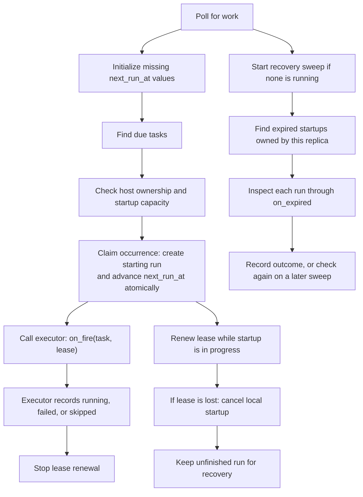

# Persistent task scheduling

`PersistentTaskScheduler` reads due tasks from the database and starts each
occurrence once across server replicas. It also checks interrupted startups so a
server crash does not leave a run in `starting` forever.

## Starting a run

Each poll fills in missing `next_run_at` values, then finds active tasks that are
due. For each task, the scheduler checks host ownership and available startup
capacity. The store creates a `starting` run and moves `next_run_at` forward in
one transaction. This is the **claim**: if another replica already claimed the
occurrence or the task changed, this attempt does not start it.

The scheduler passes the claimed run to an executor through `on_fire(task, lease)`.
The executor prepares the session and launches the work. A heartbeat keeps the
startup lease alive until the executor records `running`, `failed`, or `skipped`.
The lease covers startup; it does not last for the whole agent turn.

After downtime, an overdue task runs once and then moves to its next future time.
For example, an hourly task due at 9 AM runs once when the server returns at
12:30 PM, then again at 1 PM. Missed hours are not replayed. A task with no saved
`next_run_at` starts with its next future occurrence instead.

Creating a task or editing its schedule, time zone, or state updates `next_run_at`.
Editing its prompt does not. Recurrence intervals keep their creation-date
alignment, and `COUNT` counts occurrences strictly after creation. Invalid
schedules are paused; temporary errors or schedule-search limits leave them for
a later poll. Initialization reads one page per poll so one bad row does not
block other tasks.

The executor must await its startup work and respect cancellation. Stopping the
scheduler cancels local startups and prevents further polling until it is started
again. A database request already running in a worker thread can still commit:
a claim may be left for recovery, or a renewal may delay recovery until its new
deadline. Lease writes stay serialized until their database calls finish and
update the local run snapshot, even if their callers were cancelled. Writes still
waiting for the lease lock are cancelled without making a database call.

Constructing the scheduler enables persistent dispatch on its shared store. Do
this before serving requests, using the application's scheduler mode. Stopping
the scheduler stops its work but does not switch the store back to legacy mode.
Call `start()` and `stop()` sequentially, awaiting each before calling the next.

Startup recovery inspects unfinished `starting` runs after their leases expire.
An executor error after recording `running` does not move the run back into
startup recovery. Error logs include the last locally recorded run status.
Unexpected database-write failures are logged even if the caller was cancelled;
expected lease loss does not produce an extra error traceback.

## Recovering an interrupted startup

A lease is a deadline stored in `lease_expires_at`. Only the server actively
preparing a run renews it. Temporary renewal errors can be retried while the last
confirmed lease is valid. Once it expires, that server stops local startup work.
A different server does not renew the lease just because it now owns the host.

Recovery runs separately from due-task polling. It finds expired `starting` runs,
checks host ownership, stops any local startup still active for the run, and asks
`on_expired(run)` what happened. Expiry alone does not prove the server died or
that the prompt was never sent. Recovery must inspect the session and resources
before deciding what to preserve or clean up. It never sends another prompt.

Each server runs one recovery sweep at a time. The sweep handles expired runs in
pages, then removes eligible history for deleted tasks. Slow recovery does not
block new runs, but a large backlog can delay deleted-task cleanup. Deleting a
task immediately hides it and prevents new runs; unfinished claimed runs remain
until their result or cleanup is recorded.

Shutdown cancels and waits for local startup and recovery work. Unfinished runs
remain in the database for a later recovery sweep.

## Execution and recovery callbacks

The caller supplies execution, recovery, and host-ownership callbacks when
constructing `PersistentTaskScheduler`:

| Callback | Responsibility |
| --- | --- |
| `on_fire(task, lease)` | Start the already-claimed run and record its startup outcome. |
| `on_expired(run)` | Inspect an interrupted startup and preserve delivered work or clean up abandoned resources. |
| `owns_host(workspace_id, host_id)` | Decide whether this replica should start or recover work for the host. The default allows every host. |

`owns_host` is awaited during due-task polling, so it must return promptly and
respect cancellation.

The executor uses the existing `lease.run`, rather than inserting another run.
It calls `lease.check()` before external actions and `lease.attach_session(id)`
after creating the session, so recovery can find it. When startup is safely handed
off, it calls `lease.finish("running")`. A known failure uses `"failed"` after
cleanup; an intentional skip uses `"skipped"`. Uncertain outcomes stay available
for recovery.

For an executor that saves pending prompts, a safe handoff requires both the saved
prompt and a persisted host binding that lets the host's server continue delivery.
Submitting a sandbox-create request alone is not enough. These are responsibilities
of the supplied executor; the scheduler itself does not provision sandboxes or
deliver prompts. The executor also rechecks the owner's authorization, because a
valid lease is not permission to act as that user.

The recovery callback returns one of three results:

| Result | Meaning |
| --- | --- |
| `"running"` | Startup was successfully handed off; preserve the work. |
| `"failed"` | Startup cannot continue and cleanup has completed. |
| `None`, or an exception | The outcome or cleanup is uncertain; check again on a later sweep. |

The store accepts a recovery result only if the run still has the same expired
lease. Two replicas can still call the callback for the same run, so resource
cleanup must be safe to repeat and run concurrently. Lease checks use server
clocks, which must stay synchronized. Callbacks must respect cancellation and
keep their work inside the awaited call; cancellation cannot undo an external
request that was already accepted.

## Timing and capacity

Pass these settings to `PersistentTaskScheduler`. `ScheduledTaskSchedulerConfig`
validates them together; renewal must happen more frequently than lease expiry.

| Setting | Default | Meaning |
| --- | --- | --- |
| `poll_seconds` | 30 | Time between polls for due tasks and expired startups. |
| `renewal_seconds` | 30 | Time between startup heartbeats. |
| `lease_seconds` | 120 | Lease duration after a successful renewal. |
| `recovery_seconds` | 30 | Timeout for inspecting and recovering one run. |
| `batch_size` | 100 | Maximum rows per database page. |
| `max_startups` | 100 | Concurrent startups per server, not active agent turns. |

Values must be positive and finite; lease seconds and capacities must be whole
numbers. Settings are fixed for the scheduler's lifetime.

The store supports PostgreSQL, MySQL, CockroachDB, and SQLite. Cloudflare D1 cannot
provide the transaction needed to create a run and advance its schedule together.

## Code

[dispatch_scheduler.py](dispatch_scheduler.py) coordinates polling, heartbeats, and
recovery. [schedule.py](schedule.py) calculates occurrence times and identities.
The [store](../../stores/scheduled_task_store/sqlalchemy_store.py) implements the
atomic database operations. [config.py](config.py) validates timing and capacity.
