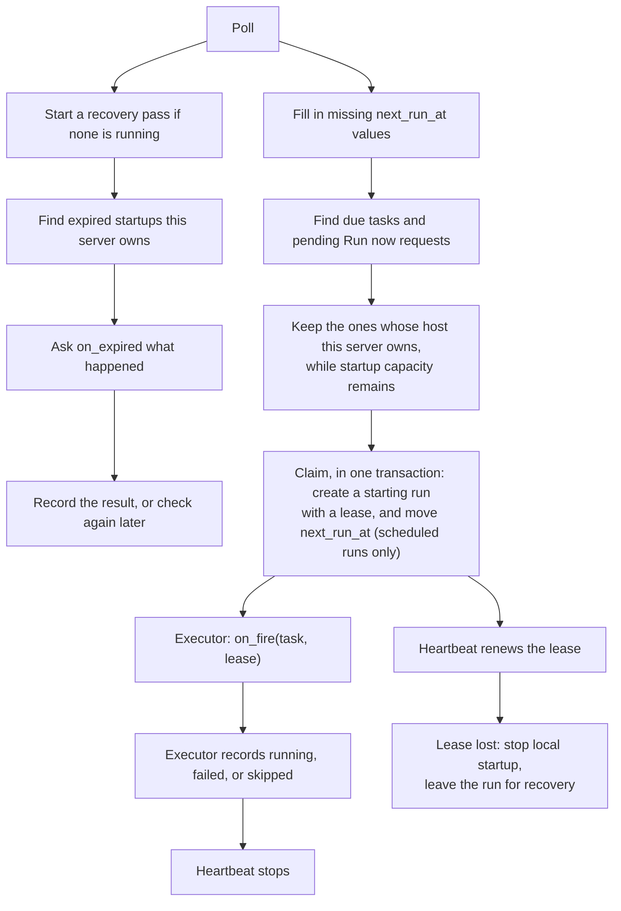
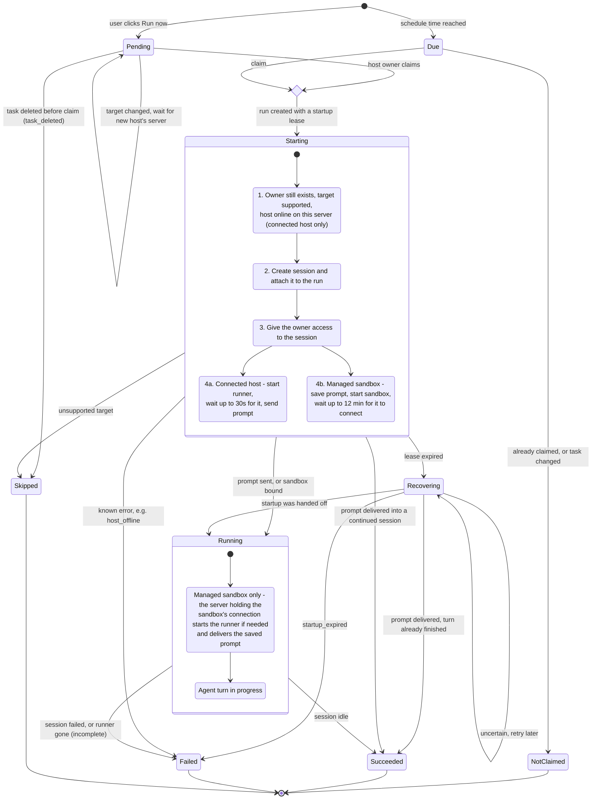
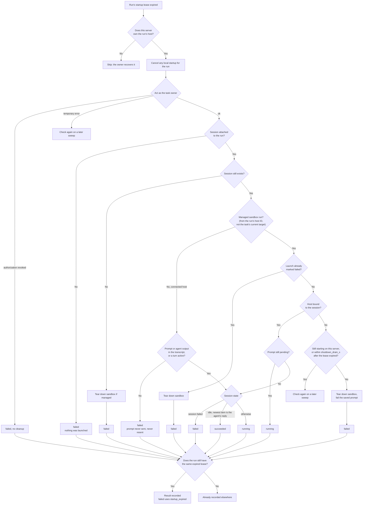

# Persistent task scheduling

Recurring schedules have a minimum interval
of **10 minutes** on connected hosts in either session mode, and in sandboxes
when continuing the existing session. Starting a new sandbox session each run
requires **one hour**. Use `FREQ=MINUTELY;INTERVAL=10` for a ten-minute schedule.

Scheduled tasks ("automations") run a saved prompt on a recurring schedule or on
demand. `PersistentTaskScheduler` keeps the schedule in the database, so every
occurrence runs once even with several server replicas, and an occurrence
interrupted by a crash is still resolved instead of staying in `starting` forever.

The `automations_v2` feature flag turns this scheduler on. It is off by default,
and the server then uses the older in-memory timers ("legacy timers").

Terms used below:

| Term | Meaning |
| --- | --- |
| Occurrence | One scheduled time of a task, or one Run now request. |
| Run | The database row recording one occurrence: `scheduled`, `starting`, `running`, `succeeded`, `failed`, or `skipped`. |
| Claim | The database write that turns an occurrence into a `starting` run. Only one server can claim an occurrence. |
| Startup | The work between the claim and handing the prompt to the agent. |
| Lease | A deadline on a `starting` run (`lease_expires_at`). The server doing the startup keeps renewing it. |
| Recovery | The background job that decides what happened to a run whose lease ran out. |
| Executor | The code that does the startup. The built-in one is `ClaimedRunExecutor`. |
| Host owner | The replica responsible for a host, chosen by `owned_hosts`. It claims and recovers that host's runs. |

## How a poll works

Every `poll_seconds`, each server does the following:

1. Starts a recovery pass in the background, unless one is still running.
2. Fills in a missing `next_run_at` for up to one page of tasks.
3. Finds active tasks that are due. For each page, it asks once which hosts it
   owns, and claims the owned tasks while it has startup capacity.
4. Reads one page of pending Run now requests and claims the ones it owns.

The claim creates a `starting` run with a lease and, for a scheduled occurrence,
moves the task's `next_run_at` forward, in one transaction. If another replica already claimed the
occurrence, or the task was edited, paused or deleted after it was listed, the
claim does not apply and nothing starts.

After a claim, the scheduler calls the executor with `on_fire(task, lease)`. A
heartbeat renews the lease until the executor records `running`, `failed`, or
`skipped`. The lease only covers startup, not the whole agent turn.



## When tasks run

- **Saved next time.** Creating a task, or changing its schedule, time zone, or
  state, recalculates `next_run_at`. Changing the prompt does not. A task without
  a saved `next_run_at` gets its next future occurrence on a later poll; one page
  of such tasks is filled in per poll, so one bad row does not block the rest.
- **Downtime.** An overdue task runs once, then moves to its next future time.
  Missed occurrences are not replayed. For example, an hourly task due at 9 AM
  runs once when the server comes back at 12:30 PM, then again at 1 PM.
- **Recurrence rules.** Intervals stay aligned to the task's creation time, and
  `COUNT` counts only occurrences after creation. An unknown time zone falls back
  to UTC.
- **Finished schedules.** When a schedule has no future occurrence left (its
  `UNTIL` or `COUNT` is used up), the task becomes `completed`. This happens on
  the final claim, on creation, or when a missing `next_run_at` is filled in.
  Changing the schedule or time zone, or resuming the task, reopens it if a future
  occurrence exists. Legacy timers never mark a task `completed`.
- **Bad schedules.** An invalid schedule pauses the task. A temporary error, or a
  schedule that takes too long to search, is left for a later poll.

## Run now

`POST /v1/scheduled-tasks/{id}/run` calls `run_now(task)`, which records a
`scheduled` run with its own `manual:<id>` trigger key. Its host ID is worked out
the same way as for a scheduled occurrence.

- If this server owns that host and has startup capacity, it claims and starts the
  run right away. Otherwise the host's owner claims it on a later poll.
- Each poll reads one page (`batch_size`) of pending requests, carrying on where
  the last poll stopped and wrapping at the end. Requests for other replicas'
  hosts therefore cost each poll at most one page.
- Once claimed, a Run now run gets the same executor, heartbeat, and recovery as
  a scheduled one.
- Run now also works on paused tasks, and never moves `next_run_at`. Each request
  is its own run and can overlap a scheduled run.
- If the task is deleted before the claim, the run is recorded as `skipped`
  (`task_deleted`) and purged with the task. If the task's target changes first,
  the claim moves the run to the new host ID and leaves it for that host's owner.
- Once the request is recorded, the route returns 202, even if starting it here
  fails; a later poll starts it. It returns 503 when the scheduler is not running.

## Startup leases

Only the server doing a startup renews its lease. If a renewal fails, it keeps
retrying while the last confirmed lease is still valid. Once the lease expires,
the store rejects that server's writes, and the server stops its local startup
work. Becoming a host's new owner does not let another server renew the lease.

Rules for executors and callers:

- The executor must await its startup work and respect cancellation.
- `start()` and `stop()` must be called one at a time, awaiting each. Stopping
  cancels local startups and stops polling until the scheduler is started again.
- A database call already running in a worker thread can still commit after a
  stop or cancellation. A claim may then be left for recovery, or a renewal may
  push recovery back to its new deadline.
- Lease writes for a run happen one at a time, and each finishes updating the
  local copy of the run even if its caller was cancelled. Writes still waiting
  their turn are cancelled without touching the database.
- An executor error after `running` was recorded does not send the run back to
  recovery. Error logs include the last run status this server recorded.
  Unexpected write failures are logged even if the caller was cancelled; an
  expected lease loss does not log an extra traceback.

Creating the scheduler switches its store to persistent mode. Do this before
serving requests, based on the app's scheduler mode. Stopping the scheduler does
not switch the store back.

## Recovering an interrupted startup

A lease running out does not prove the server died, or that the prompt was never
sent. Recovery therefore runs separately from polling and looks at the evidence
before deciding:

1. It finds `starting` runs whose lease has expired.
2. It keeps the ones whose host this server owns.
3. It cancels any local startup still running for the run.
4. It asks `on_expired(run)` what happened, and records the answer.

Recovery never sends the prompt again.

Each server runs one recovery pass at a time:

- A pass inspects at most `batch_size` expired runs, then removes one page of
  leftover history for deleted tasks. The next pass carries on from there.
- A scan keeps the expiry cutoff it started with until it reaches the end. It then
  starts over, which picks up newly expired leases and revisits runs it could not
  decide.
- Slow recovery does not delay new runs, and deleted-task cleanup gets a turn
  between recovery pages.

Deleting a task hides it and stops new runs at once. Its unfinished claimed runs
stay until their result or cleanup is recorded. If cleanup for one deleted task
fails, it is logged and skipped until the next scan, so other tasks still get
cleaned up.

On shutdown, the server cancels its local startups and recovery work and waits for
them. Unfinished runs stay in the database for a later recovery pass.

## The built-in executor

`ClaimedRunExecutor` in [fire.py](fire.py) runs the same steps as a legacy fire,
but records each one on the claimed run instead of inserting a new run:

1. **Check.** The owner still exists, the target is supported, and for a connected
   host, the host is online on this server.
2. **Create the session.** It renews the lease first, then attaches the session to
   the run right away, so recovery can find it.
3. **Grant the owner** access to the session.
4. **Launch.** It renews the lease again, then:
   - **Connected host:** starts a runner on the host, waits up to 30 seconds for
     it to connect, sends the prompt, and records `running`.
   - **Managed sandbox:** saves the prompt in the session, then starts a sandbox
     under the run's `host_id`, so the sandbox connects to the replica that owns
     that ID. It records `running` once the session stores the sandbox's host;
     until then, no other replica can finish the launch or deliver the prompt.
     The server holding the sandbox's connection then delivers the saved prompt.
     A sandbox that has not connected within 12 minutes is abandoned: the saved
     prompt fails, the launch is cancelled, the sandbox is torn down, and the run
     fails with `sandbox_registration_timeout`.

A task that continues a session replaces steps 2 to 4 once it has a
`session_id`: it checks the session, wakes its runner the way a user message
would, and sends the prompt, also while the session is busy with an earlier turn.
It records `succeeded` once the prompt is delivered, without waiting for the turn.
If the replica stops before recording, recovery finds no session on the run and
records `failed`; it never resends. A first run of such a task records its
session on the task once the session exists and its owner is granted, so a run
never finds a recorded session it cannot continue. Of two first runs, the one that records
second deletes its unused session and records `skipped`.
Sandbox tasks accept an optional repository URL in `workspace`, validated with
the same repository grammar as a new sandbox session. The selected repository is
passed to sandbox launch and recorded in the session's repository labels for
relaunch. `host_id` remains forbidden. The API advertises this support as
`scheduled_task_sandbox_workspaces`; older servers reject sandbox workspaces.
Selecting Provider default clears a repository pin with `workspace: null`.
Edits also clear legacy directory pins without resetting an unchanged continued
session, since those pins already use the provider default.
Switching execution targets clears the old workspace unless the request supplies
a replacement, since connected-host paths and repository URLs are different inputs.

A sandbox task's first run starts its sandbox under the task's host ID. If that
host already exists, left by a reset session, the new session joins it in that
session's workspace, or replaces its sandbox when that session is unknown or
the selected repository changed.

Known failures record `failed` with the same `error_code` as legacy fires, such as
`host_offline` or `launch_failed`. A managed launch records where it failed instead:
`sandbox_create_failed` before the host connects, or `runner_start_failed` after.
An unsupported target records `skipped`.

Like legacy fires, it stamps `last_run_at` and `last_run_conversation_id` on the
task. Both paths create sessions with the same helper, so per-task settings such as
the model override apply to both.

### Acting as the owner

The executor runs under the owner's account and host-owner scopes, like legacy
fires. If `fire_identity` is set, it enters that first:

| When entering the identity… | Result |
| --- | --- |
| Raises `FireIdentityRevoked` | The run fails with `reauthorization_required`, and no session is created. If the owner was deleted, the task is disabled with `owner_deleted` instead. |
| Raises any other error | Treated as temporary: the run fails with `owner_identity_unavailable`, and the next occurrence tries again. |

Recovery enters the same identity before inspecting a session. A temporary error
leaves the run for a later pass. `FireIdentityRevoked` records `failed` without
inspecting or cleaning up, so a sandbox is left to the provider's lifetime cap.

Work a fire starts in the background, such as the sandbox launch, copies the
identity's context variables and can outlive the fire. The identity's `__aexit__`
must not revoke credentials that work still uses.

### Recovery evidence

The built-in recovery decides from the saved session, as shown in
[How recovery decides](#how-recovery-decides). A few rules keep it from guessing
wrong:

- A run counts as a managed sandbox run when its `host_id` is the sandbox ID
  derived from its task and trigger key, or, for a task that continues a
  session, from its task alone. This uses the run, not the task's current
  target, which may have been edited since the claim.
- An `idle` session alone does not mean the turn finished: a session can be idle
  with its prompt saved but never run. Runner bookkeeping such as `resource_event`
  items does not count as evidence either.
- Recovery never tears down a continue task's sandbox: other sessions of the task,
  such as one started after a reset, may be using it, and the task's next run
  reuses it. The provider's lifetime cap still applies.
- Teardown only applies to server-managed sandbox hosts, and is safe to repeat, so
  two replicas can recover the same run.

## Run states and interruptions

These diagrams cover the database scheduler with the built-in executor. They show
how one run moves between states, and what happens when the server preparing it
dies, stalls, or loses its lease at each step.

### Run lifecycle



- A claim creates the `starting` run with its startup lease and moves the task
  to its next time, or marks it `completed`, in one transaction. It does not
  apply if the occurrence was already claimed or the task changed.
- A heartbeat renews the lease every 30 seconds. If the server dies or stalls,
  renewals stop; after expiry the store rejects its writes and recovery decides.
  An unexpected executor error also leaves the run for recovery.
- Startup failures use the executor's `error_code`, such as `host_offline`,
  `launch_failed`, or `sandbox_registration_timeout`. Recovery uses
  `startup_expired`.
- Any idle edge records `succeeded`. A failed session records `failed`, including
  a saved prompt that could not be delivered. A runner gone past its liveness
  window is failed as `incomplete` when sessions are listed or stopped, and a run
  still `running` after 6 hours is failed as `incomplete` when the task's runs are
  read.

### When the server stops partway

Recovery starts within about one lease plus one poll after renewals stop
(about 2.5 minutes with the defaults). It runs on the server that owns the run's
host; with a single replica, that is the restarted server.

| Server stops… | Saved state | What happens next | Result |
| --- | --- | --- | --- |
| Before the claim commits | Nothing changed | The next poll claims the occurrence | Runs normally, just late |
| After the claim, before the session exists | Run is `starting`, no session | Recovery finds nothing was launched | `failed` (`startup_expired`); the occurrence is not retried |
| Connected host, session created, prompt not sent | Session without the prompt | Recovery finds no prompt, agent output, or active turn | `failed`; the prompt is never resent, and a runner already started on the host is left idle |
| Connected host, prompt sent, `running` not recorded | Session has the prompt | Recovery reads the session | `running`, `succeeded` if the turn already ended, or `failed` if the session failed |
| Managed sandbox, prompt saved, sandbox still starting | Saved prompt, no host bound | Recovery waits `shutdown_drain_s` past the lease expiry, because a shutting-down server may still bind the sandbox | Bound in time: `running`, and the sandbox's server delivers the prompt. Otherwise: sandbox torn down, prompt failed, `failed` |
| Managed sandbox, launch already failed | Session startup marked failed | Recovery tears down any sandbox for the run | `failed` |
| Managed sandbox, after `running`, before the runner started | `running`, host bound, prompt pending | The server holding the sandbox's connection starts the runner and delivers the prompt | Normal `succeeded` or `failed` |
| Session deleted | Run points to a missing session | Recovery tears down the sandbox of a managed run | `failed` |
| Alive but stalled past the lease | Lease expired | Its late `running` or `failed` write is rejected, it stops local work, and recovery decides as above | As above |
| Executor raised unexpectedly | Run still `starting` | Logged as `interrupted`; recovery decides once the lease expires | As above |
| Mid-turn, after `running` | `running`, no lease | If the host reconnects, the turn ends normally. If the runner is gone, the run fails as `incomplete` when sessions are listed or stopped, or after 6 hours when the task's runs are read | `succeeded` or `failed` |
| Recovery cannot decide (database error, temporary identity error, timeout) | Unchanged | A later sweep checks again | Decided later |
| Owner authorization revoked | Unchanged | Recovery does not inspect or clean up; a sandbox is left to the provider's lifetime cap | `failed` |

### How recovery decides

When a startup's lease expires, recovery inspects what the run saved and chooses its
final status without resending the prompt, as shown below.



### Behavior to review

These came from reading the code and have not been checked against a running
deployment:

- Any idle edge on a fired session records the run `succeeded`, including a user
  pressing Stop or a policy denying the prompt. This would overstate fire success.
- Recovery tears down only managed sandboxes. If a connected-host startup stops
  after launching the runner but before sending the prompt, the run fails and the
  idle runner stays on the host.
- `host_offline` means the host is not connected to this server. With several
  replicas, this relies on `owned_hosts` sending the run to the server that holds
  the host's connection.
- An interrupted occurrence is not retried. Recovery records `failed`, and the
  task waits for its next scheduled time.
- Each poll reads one page of pending Run now requests, so on a server with many
  pending requests for other replicas' hosts, a request can wait a few polls.

## Custom callbacks

A deployment can replace parts of the scheduler by passing
`ScheduledTaskDispatchHooks` to `create_app(scheduled_task_dispatch=...)`. Hooks
it leaves out use the defaults:

| Callback | What it does | Default |
| --- | --- | --- |
| `on_fire(task, lease)` | Starts the claimed run and records how startup ended. | The built-in executor |
| `on_expired(run)` | Inspects an interrupted startup, keeps delivered work, and cleans up abandoned resources. | The built-in executor |
| `owned_hosts(keys)` | Returns the host keys this replica owns, so it only starts or recovers that work. | Every key |
| `fire_identity(task)` | An async context manager the built-in executor enters to act as the task's owner, for example by assuming a stored delegation. | None |
| `dispatch_enabled()` | Whether this replica may dispatch. Checked at the start of each poll and before Run now starts a run here. See [Pausing dispatch](#pausing-dispatch). | Always on |
| `poll_interval()` | Seconds to wait before the next poll, read before each wait. Overrides `poll_seconds` without a restart. | `poll_seconds` |

Replace `on_fire` and `on_expired` together or not at all. `fire_identity` only
works with the built-in executor; a replacement executor acts as the owner itself.

Give each app its own scheduled-task store object. `create_app()` sets that
object's scheduling mode, so a shared object lets one app overwrite another's
mode. Separate objects can share a database, as long as every replica uses the
same mode.

### Host ownership

- A key is the occurrence's host ID, or, for a task with no host, the workspace ID
  as a decimal string. Host IDs are bare lowercase 32-character hex, the same
  string a host or sandbox sends as its routing key.
- A task that continues a session keys every run, its first included, by one
  host: its pinned connected host, or for a sandbox task a host ID derived from
  the task alone, so the replica holding that sandbox's connection runs it. A
  connected-host task without a pin is pinned to its session's host when the
  session is recorded or picked, so only its first run, before any session
  exists, keys by the workspace ID.
- The scheduler calls `owned_hosts` once per page of due tasks, of Run now
  requests, and of expired startups, listing each key once.
- If the call raises, or takes longer than `recovery_seconds` during recovery,
  this replica owns none of that page. Skipped due tasks are checked again on the
  next poll; skipped Run now requests and expired startups once their scan starts
  over.
- Polling waits for `owned_hosts`, so it must return quickly and respect
  cancellation.

### Pausing dispatch

When `dispatch_enabled()` returns false, a poll does nothing: it reads no tasks,
claims nothing and starts no recovery pass. Run now records the request but
leaves it pending. The loop keeps waking at the poll interval and resumes on the
first poll after the check returns true again.

- Tasks, runs and pending requests are kept. Startups already in progress keep
  renewing their leases and finish; a run left `starting` is recovered once
  dispatch resumes.
- When dispatch resumes, an overdue task runs once and then moves to its next
  future time, as after downtime. Pending Run now requests start on that poll or a
  later one.
- A check that raises is logged and counts as on, so a failing flag lookup does
  not stop every automation.
- The routes stay available. To hide them too, also turn off
  [the automations gate](#turning-automations-off-for-some-callers).

A `poll_interval()` that raises, or returns a value that is not a positive
finite number, is logged and the scheduler waits `poll_seconds` instead.

### Writing an executor

- Use the existing `lease.run`; do not insert another run.
- Call `lease.check()` before each external action, and
  `lease.attach_session(id)` right after creating the session, so recovery can
  find it.
- Call `lease.finish("running")` once startup is safely handed off,
  `lease.finish("failed")` for a known failure after cleaning up, and
  `lease.finish("skipped")` for an intentional skip. Leave uncertain outcomes for
  recovery.
- If the prompt is saved for later delivery, a safe handoff needs both the saved
  prompt and a stored host binding that lets the host's server continue delivery.
  Submitting a sandbox-create request alone is not enough.
- Recheck the owner's authorization: a valid lease is not permission to act as
  that user.

The scheduler itself never provisions sandboxes or delivers prompts; that is the
executor's job.

### Writing a recovery callback

`on_expired(run)` returns one of these:

| Result | Meaning |
| --- | --- |
| `"running"` | Startup was handed off; keep the work. |
| `"succeeded"` | The prompt was delivered and the turn already finished. Recovery records this itself, because the turn-completion hook only updates `running` runs. |
| `"failed"` | Startup cannot continue, and cleanup is done. |
| `None`, or an exception | The outcome or cleanup is unclear; check again on a later pass. |

- The store accepts the result only if the run still has the same expired lease.
- Two replicas can still call the callback for the same run, so cleanup must be
  safe to repeat and to run at the same time.
- Lease checks use server clocks, which must stay in sync.
- Callbacks must respect cancellation and do all their work inside the awaited
  call. Cancelling cannot undo an external request that was already accepted.

## Configuration

These are the defaults, set in the server YAML configuration:

```yaml
scheduled_task_scheduler:
  startup_retry_seconds: 30  # Wait before retrying a failed scheduler start, in either mode
  poll_seconds: 30       # Time between checks for due tasks and expired startups
  renewal_seconds: 30    # Time between startup heartbeats
  lease_seconds: 120     # How long a lease lasts after each renewal
  recovery_seconds: 30   # Time limit for inspecting and recovering one run
  batch_size: 100        # Most rows read in one database page
  max_startups: 100      # Startups in progress per server (not running agent turns)
```

- Leave out the section, or any setting, to use the default.
- The CLI reads the file passed with `omnigent server -c path/to/config.yaml`.
  Otherwise `create_app()` reads `server_config` if a wrapper passes it, or the
  file named by `OMNIGENT_CONFIG`. A wrapper can also pass
  `scheduled_task_scheduler_config=ScheduledTaskSchedulerConfig(...)` to replace
  the YAML settings.
- Settings are read at startup; the `poll_interval` hook can change the poll
  interval while running. Values must be positive and finite, lease seconds
  and capacities must be whole numbers, and `renewal_seconds` must be less than
  `lease_seconds`.
- With the flag on, an invalid setting stops the server from starting. With the
  flag off, only `startup_retry_seconds` is read and checked.

## Turning automations off for some callers

A deployment can pass `create_app(automations=...)`: a bool, or a zero-arg
callable checked on each request, for example a per-workspace flag. When it is
off for a request, every `/v1/scheduled-tasks` route returns 404, including the
agent tools that call them, and `GET /v1/info` reports `automations_enabled`
false so clients can hide the feature. A callable that raises counts as off. The
gate does not stop the scheduler: tasks created while it was on keep running,
and can be paused or deleted only once it is on again. Omitting it enables
automations.

## Sub-hour schedule rollout

API validation and both schedulers always support the target/mode minimums above.
`/v1/info` reports the fixed `scheduled_task_subhour` capability so newer clients
retain the hourly floor on older servers. The custom UI also needs `automations_v2`.

Upgrade scheduler replicas before API replicas begin accepting sub-hour schedules,
and avoid routing writes across mixed API versions during the rollout. Older API
replicas reject short schedules; older schedulers can pause them as invalid.
Keep the existing scheduler mode unchanged during the version upgrade.

Updates validate the proposed recurrence, session mode and target outside the
database transaction, then compare their saved values under the task row lock.
A concurrent change returns HTTP 409 without applying any fields; reload and
revalidate before retrying. Metadata-only writes do not revalidate saved cadences.

Before rolling binaries back to a version with the hourly-only parser, stop
accepting sub-hour schedules, pause them and change their recurrence to hourly
or slower (or delete them). An old scheduler can durably pause unsupported rules
and clear `next_run_at`, even before its host-ownership filter. Restoring the new
binary does not automatically resume tasks paused by an old scheduler.

## Switching schedulers

**Turning it on.** Set `OMNIGENT_FEATURES=automations_v2` and restart all
scheduler replicas together. The app needs a store that supports persistent
dispatch. Without `scheduled_task_dispatch`, it uses the built-in executor and owns
every host, which suits a single replica. A deployment with several replicas passes
its own `owned_hosts`.

**Turning it off.**

1. Stop new startups, and let existing ones finish or be recovered.
2. Set `OMNIGENT_FEATURES=-automations_v2` and restart all replicas.

On startup, legacy mode clears saved `next_run_at` values before creating its
timers, and records pending Run now requests as `skipped` (`dispatch_disabled`).
Clearing the saved times stops a later switch back from replaying occurrences the
timers already handled. Task definitions, run history, and running agent sessions
are kept.

**Mixed modes.** Every replica sharing a database must use the same mode, because
legacy timers do not claim occurrences. Changing the environment of a running
server does not switch its scheduler. The flag is shown in `/v1/info`;
per-workspace access controls are separate.

**Databases.** The store supports PostgreSQL, MySQL, CockroachDB, and SQLite.
Cloudflare D1 cannot run the transaction that creates a run and moves the schedule
together.

### Startup and shutdown details

- If clearing the saved times or starting the scheduler fails, the server retries
  after `startup_retry_seconds`, in either mode. Persistent startup normally only
  launches the polling loop; database errors inside the loop retry after
  `poll_seconds`.
- Legacy timers become available to routes after the saved times are cleared, and
  before tasks are loaded. Changes made during loading win over what was loaded. A
  failed load clears any timers it created before retrying.
- In persistent mode, task routes return saved `next_run_at` values even when the
  scheduler is not running.
- Database reads and cursor resets run off the event loop.
- Shutdown stops scheduling before the sandbox reaper, and waits for a running
  cursor reset, so a slow database write can delay shutdown. It does not wait for
  a pending legacy task read: that thread may hold a connection until its query
  finishes, but its result can no longer create timers. Process exit may still
  wait for the thread pool, so set database and driver timeouts to bound it.

## Debug-log events

Persistent dispatch (`automations_v2`) writes structured `debug_event` records to
normal server logs and, when enabled, the shared debug-log table. Delivery and
startup results, including failures, are INFO events: dashboards need INFO
capture. The sink is best-effort, so missing events are not proof that a prompt
was never sent.

Run events carry `task_id`, `run_id`, `task_workspace_id`, `scheduled_at`, and
`trigger_key`. Due-occurrence observations, claim attempts, and skipped claims have no run ID. Use
`(task_workspace_id, task_id, trigger_key)` for occurrence identity: manual runs
can share a timestamp with a scheduled run without being duplicates.

The executor scopes ordinary server logs and child tasks with occurrence IDs,
`target`, and `session_mode`. Managed startup inputs persist these fields in
`startup_options` and restore them on the delivering replica, including after a
restart. They are not forwarded as prompt content. Host launch frames and runner HTTP requests carry the same context. The host
scopes launch logs and the runner scopes request logs; shared clients stamp each
request separately, and interactive requests clear the occurrence fields. Buffered inputs
retain their own occurrence (or explicit absence) through queue drains and sign-in
retries. Telemetry does not change live steering or SDK queue coalescing. An
interactive correction can still steer an active automation turn. Ordinary execution
logs retain the initiating turn's context. A batch combining different input
contexts has no single turn occurrence. These logs do not divide model output or
execution cost among inputs.
Session-wide relays and prompt/sign-in watchers clear occurrence context. Host
exit watchers retain launch attribution only for confirmed pre-connect failures. No
process-wide run ID is installed: continued sessions can serve multiple runs and
interactive turns. Unrelated host heartbeats and process-lifecycle logs still
join by host, runner, or session ID. Legacy timers and saved inputs created before this instrumentation do
not have the new delivery correlation.

| Event | Logged when | Extra attributes |
| --- | --- | --- |
| `scheduled_run_occurrence_observed` | A replica reads a due occurrence, before schedule validation or host ownership lookup. Repeated polls are suppressed by a per-replica LRU cache of 4,096 tasks. May repeat across replicas, restarts, or cache eviction. | `target`, `observed_at`, `rrule`, `timezone`, `schedule_anchor` |
| `scheduled_run_claim_attempted` | The owning replica tries a due schedule occurrence, before the DB claim. May repeat on later polls. | `target` |
| `scheduled_run_claimed` | A due occurrence or Run now request was claimed. | `target`, `host_id`, `claim_delay_seconds` |
| `scheduled_run_claim_skipped` | The occurrence was already claimed, or the task changed, paused, or was deleted. | `target` |
| `scheduled_run_session_created` | A new session was created, before owner grants and host/sandbox startup. Continued-session sends do not emit this event. | `session_id`, `session_delay_seconds` |
| `scheduled_run_session_attached` | The executor attached or replaced its session. | `target`, `session_delay_seconds` |
| `scheduled_run_startup_ended` | Startup ended on its executing server. | `target`, `outcome`, `error_code`, known `failure_stage`, `startup_delay_seconds` |
| `scheduled_run_prompt_dispatch_started` | The server begins a direct send or processes a saved input through normal dispatch. A competing saved-input worker may lose the claim and send nothing. | `session_id`, `dispatch_id`, saved `input_id` when applicable |
| `scheduled_run_prompt_sent` | Dispatch returned explicit runner acceptance, before saved-input housekeeping. Failures inside dispatch after acceptance can suppress this event (see below). Handled native startup refusals do not count. | `session_id`, `dispatch_id`, `input_id` when saved, `prompt_delay_seconds`, `target`, `session_mode` |
| `scheduled_run_prompt_not_accepted` | Direct dispatch returns a handled refusal. Logs the non-delivery without raising or changing the existing run-status flow. | `session_id`, `dispatch_id`, `failure_stage=prompt_send`, `outcome=not_sent` |
| `scheduled_run_stage_started` | A fire enters a new stage, before potentially blocking/failing work. Consecutive nested entries into the same stage are suppressed per run. Gives the last observed boundary when a process dies. | `fire_stage` |
| `scheduled_run_stage_failed` | Runner startup, prompt dispatch, managed launch, or post-delivery bookkeeping failed. | `failure_stage`, `exception_type` or `error_code`; saved-input failures also include `input_id`, `dispatch_id`, `outcome` |
| `scheduled_run_stage_interrupted` | A direct runner startup or prompt send was cancelled. | `failure_stage`, `outcome=uncertain` |
| `scheduled_run_prompt_dispatch_interrupted` | A saved-input delivery was cancelled. | `input_id`, `dispatch_id`, `outcome` |
| `scheduled_run_recovered` | Recovery inspected an expired startup. | `outcome` |
| `scheduled_task_operation_failed` | An operation failed and will be retried. | `operation`; a single-occurrence claim failure also includes occurrence identity and `failure_stage=claim` |

`session_id` is a top-level log field; other dimensions are attributes. Attribute
values in the sink are strings; cast delays before computing percentiles.

`prompt_sent` observes a successful dispatch return, which includes work after
runner acceptance. If that work fails (for example, publishing input consumption
or writing a smart-routing label), the prompt may already be running without a
`prompt_sent` event. Direct delivery records a `prompt_send` stage failure;
saved-input delivery reports `outcome=uncertain`. Existing exception propagation,
run statuses, and retry behavior remain unchanged. Thus accepted-delivery counts
are a lower bound, and missing sent events cannot establish non-delivery or zero
duplicates. Delivery latency also includes dispatch bookkeeping time. Correlate
`turn_dispatched` or `native_input_forward_finished` and runner records when
investigating these cases; they do not replace a durable delivery ledger.

`startup_ended` outcomes are `running`, `succeeded` (continued-session delivery),
`failed`, or `skipped`; unresolved startup paths report `lease_lost`,
`interrupted`, `unfinished`, or `cancelled`. `recovered` outcomes are `running`,
`succeeded`, `failed`, `uncertain`, `superseded`, `timeout`, or `error`.

`scheduled_task_operation_failed.operation` is `poll`, `initialize`, `claim`,
`recovery`, `cleanup`, or `lease_renewal`. Claim failures and single-task
initialization failures include `task_id` and `task_workspace_id`; failed scans
and ownership lookups have neither.

Scheduler claim, session-attachment, and startup delays measure from the scheduled
time to when recording the step was requested, excluding the corresponding
database write time. The newer prompt-delivery delay measures the successful
dispatch return described above. A startup cancelled before its first step emits
no `startup_ended`; recovery records its outcome later.

Startup and delivery are separate boundaries. A managed startup ends when the
sandbox binds, before its prompt is sent. The older `prompt_delay_seconds` field
on `startup_ended` remains for compatibility; it measures that startup boundary.
Use **only `scheduled_run_prompt_sent.prompt_delay_seconds`** for time to prompt.
A sent prompt can still fail during agent execution; native runner acceptance
also precedes the harness's transcript receipt.

Saved-input failure/interruption outcomes distinguish `not_sent` (no dispatch
claim), `uncertain` (claimed but dispatch did not return success), and `sent`
(dispatch succeeded, subsequent bookkeeping failed or was interrupted). A claim
alone is never reported as successful delivery. Interrupted work is not retried
by this telemetry.

Known startup error codes identify owner identity/grant, session creation/record,
sandbox creation/registration, and runner startup failures. Direct runner-start
and prompt-send exceptions have separate stage events even though the persisted
run still uses `launch_failed`. Saved-input failures distinguish `owner_authorization`, `input_validation`,
`input_policy`, `runner_start`, `prompt_prepare`, `input_claim`, `prompt_send`, and
`post_delivery`. Startup failures also identify host/session/budget validation.
For a crash, inspect the last `stage_started` (or `sandbox_launch_stage`) for the
run. It is the last observed boundary, not proof of the exact crash location;
`startup_expired` remains explicitly unknown when recovery has no such evidence.

| Metric | How to calculate it |
| --- | --- |
| Observed fire success | Distinct occurrence keys with `prompt_sent` divided by distinct observed schedule keys from `occurrence_observed`/`claim_attempted`/`claimed`, excluding intentionally skipped occurrences. Due observations retain visibility of ownership and validation failures; claim attempts retain DB claim failures that created no run. Filter `trigger_key` to `schedule:` for scheduled-only metrics; report manual runs separately. |
| Duplicate fires | Occurrences with more than one distinct `run_id` in `prompt_sent`. Failed attempts with no accepted prompt do not count as duplicate fires. |
| Duplicate sends | Occurrences with more than one distinct `dispatch_id` in `prompt_sent`, after deduplicating ingested rows by `log_id`. This also detects repeated delivery within one run; duplicate claims remain separately protected by the DB constraint. |
| Session creation count | Count distinct `session_id` values on `session_created`, grouped by occurrence or run. Useful for diagnosing repeated creation; a created session does not prove a prompt was sent. |
| Fire delay | p90 of `session_created.session_delay_seconds`, before owner grants or sandbox boot. The older `session_attached` delay remains for compatibility. Continued-session runs do not create another session. |
| Time to prompt | p90 of `prompt_sent.prompt_delay_seconds`, split by `target` and optionally `session_mode`. Includes sandbox boot and runner readiness. |
| Fires per day and target split | Distinct delivered run IDs by `target`; use `claimed` for attempted fires. Active tasks and distinct active owners come from `scheduled_tasks`. |

The due-observation schedule snapshot can reconstruct recurrence times between
`scheduled_at` and `observed_at`, including intervals the scheduler skips during
delay. Deduplicate by occurrence and exclude known outage windows from separate
availability telemetry. This remains a best-effort observation stream, not a
durable ledger: no logs can count an occurrence whose schedule was never
observed, or recover records dropped by the sink.
Recovery evidence and transcripts can help investigate missing delivery events,
but `recovered=running` alone is not a replacement for a prompt-sent event.

Startup results are emitted after the DB write commits, including writes whose
callers were cancelled. Recovery can log `timeout` and later a committed result,
and can log `uncertain` on multiple passes. Shutdown can drop pending log writes.

To verify in a deployment with INFO capture, trigger a pinned-host automation and
a sandbox automation, then filter the debug table by `attributes['run_id']`.
Check that the sandbox's `startup_ended` can precede `prompt_sent`, and that only
`prompt_sent` reports delivery latency. Repeat with a continued-session automation,
then a refused input: continuation should emit a sent event; refusal should emit
a stage failure (raised errors) or `prompt_not_accepted` (handled direct refusal),
with no sent event for that dispatch. Handled native refusals preserve the
existing normal-return path and session failure persistence; telemetry does not
force a new scheduled-run status. The automated restart and
competing-worker scenarios live in `test_managed_startup_inputs.py`.

### Adoption and creation funnel

`scheduled_task_created` is an INFO server event emitted after task persistence,
for UI, API, and agent-tool creates. Its top-level `user_id` is the authenticated
owner (`local` for auth-disabled servers); attributes are `task_id`,
`task_workspace_id`, `creation_source` (`ui`, `agent`, or `api`), `template_id`,
`target`, and `session_mode`. Rejected creates emit no creation event. As with
run logs, delivery is best-effort; reconcile current inventory against the store.

Requests without a recognized source header are classified as `api`, including
older web and agent clients. During a mixed-version rollout, `creation_source`
therefore does not precisely distinguish direct API usage from those clients.

UI events use the host-provided `OmnigentHostConfig.analytics` sink:

| Metric | Measurement |
| --- | --- |
| Feature visitors | Distinct host-identified users on `page_view` with `pageId=tasks`, `tasks.templates`, or `tasks.detail`. |
| Users creating automations | Distinct `(task_workspace_id, user_id)` on `scheduled_task_created` in the reporting window. |
| Automations created per person | Distinct `task_id` per owner on `scheduled_task_created`, including tasks later deleted while events remain retained. |
| Active tasks and active owners | Use `scheduled_tasks` filtered to `state=active`; group by workspace and owner. This is a current snapshot, not historical daily activity. |
| Template selections | `click` with `componentId=tasks.template.<id>`, from both the empty-state preview and Templates tab. |
| Successful template use | `scheduled_task_created` grouped by `template_id`; distinct owners gives template users. |
| UI creation attempts, successes, failures, latency | `interactionKind=create_scheduled_task`: `phase=start`, then `phase=complete` with `status=success` or `failure` and duration. `name` is the template ID. |
| UI / agent / API share | `scheduled_task_created` grouped by `creation_source`. |

Template IDs are bounded: `custom`, `jira`, `slack`, `github`, `linear`,
`follow-up-monitor`, `pr-sweep`, `news-digest`, or server-side `unknown` for
unattributed/older clients. The current gallery offers Jira, Slack, GitHub, and Linear;
the three retired suggestion IDs remain accepted for older clients. Attribution records the selected template even if
its prompt is edited. No task name, prompt, Jira query, channel, or repository
text is recorded in these events. Attribution headers are diagnostic client claims;
they never determine ownership or authorization.

The host sink supplies user/workspace identity for UI analytics. Without that
sink (for example standalone web), UI events are no-ops; server creation logging
still works when INFO capture is enabled. A browser failure can follow a
committed server creation if the response is lost: use server task IDs for
creation counts, and UI outcomes for the browser funnel. Do not add both streams
together. Page visits, creators, and owners of active tasks answer different
questions; report them separately. Existing owners are not retroactively
counted as new creators.

To verify, configure a host analytics capture, visit Automations and its Templates
tab, create one custom task and one template task, then cancel another form.
Expect page views, one template click per selection, successful creation
interactions and one server creation event per saved task, and no creation event
for the cancelled form. Check task ID and owner against the store; delete the
probe tasks afterward. Run `tests/server/integration/test_scheduled_tasks_routes.py`
and `web/src/lib/scheduledTasksApi.test.ts` for rejected-create and attribution
coverage.

## Code

- [dispatch_scheduler.py](dispatch_scheduler.py): polling, heartbeats, and
  recovery.
- [fire.py](fire.py): the fire steps shared by both schedulers, and the built-in
  executor.
- [schedule.py](schedule.py): occurrence times and identities.
- [The store](../../stores/scheduled_task_store/sqlalchemy_store.py): the atomic
  database operations.
- [config.py](config.py): timing and capacity settings.
