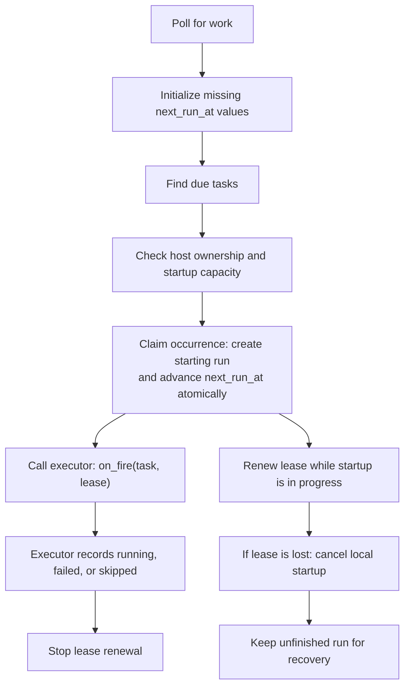

# Persistent task dispatch

`PersistentTaskScheduler` finds due tasks in the database, claims each occurrence
through the store, and supervises the executor while it prepares the run.

1. Initialize a future `next_run_at` for active tasks that have none.
2. Find due tasks and check whether this server owns the occurrence's host.
3. Atomically create a `starting` run and advance the task to its next future time.
4. Call `on_fire(task, lease)` and renew the startup lease while it works.
5. Stop renewal when the executor records `running`, `failed`, or `skipped`.

The database claim decides which replica starts each occurrence. The executor
runs alongside the heartbeat and uses `StartupLease` to check its lease, attach
the session, and record the startup outcome. The lease covers startup, not the
entire agent turn.

The executor checks its lease before external actions, attaches the session before
sending the prompt, and records `running` after delivery. Lease loss stops local
startup work. Interrupted `starting` runs remain recorded for recovery; the scheduler
never resends a prompt automatically. After an outage it dispatches one overdue
occurrence per task, then advances into the future instead of replaying every
missed occurrence.

The executor must await its startup work and respect cancellation. Stopping the
scheduler cancels local startups and prevents further polling until it is started
again. A database request already running in a worker thread can still commit:
a claim may be left for recovery, or a renewal may delay recovery until its new
deadline. Lease writes stay serialized until their database calls finish and
update the local run snapshot, even if their callers were cancelled. Writes still
waiting for the lease lock are cancelled without making a database call.

By default, every host is eligible. Deployments that assign hosts to replicas
supply an `owns_host` callback, including ownership of derived sandbox host IDs.
The poll awaits this callback, so it must return promptly and respect cancellation.

Defaults are 30-second polls and renewals, 120-second leases, 100 rows per page,
and 100 concurrent startups per server. `ScheduledTaskSchedulerConfig` validates
these settings; renewal must occur more frequently than lease expiry.

Constructing the scheduler enables persistent dispatch on its shared store. Do
this before serving requests, using the application's scheduler mode. Stopping
the scheduler stops its work but does not switch the store back to legacy mode.
Call `start()` and `stop()` sequentially, awaiting each before calling the next.

Startup recovery inspects unfinished `starting` runs after their leases expire.
An executor error after recording `running` does not move the run back into
startup recovery. Error logs include the last locally recorded run status.
Unexpected database-write failures are logged even if the caller was cancelled;
expected lease loss does not produce an extra error traceback.
